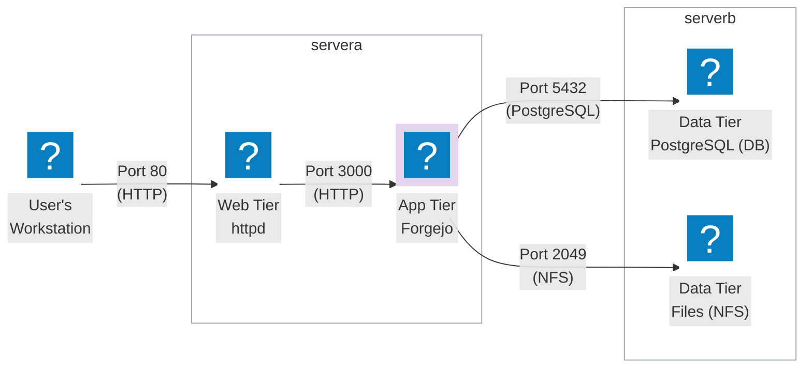

# The App Tier

## Where the application's code runs

---
horizontal: center
vertical: center
---

# The App Tier in the Architecture



Forgejo, in a container on `servera`, with its data on `serverb`

---
horizontal: center
vertical: center
---

# Designing an App Tier

<IconGrid>
<IconGridItem icon="renew">

**Stateless**, so it can be replaced

</IconGridItem>
<IconGridItem icon="locked">

**Least privilege** for its process

</IconGridItem>
<IconGridItem icon="power">

**Availability** across reboots

</IconGridItem>
<IconGridItem icon="settings">

**Configuration** passed in at start

</IconGridItem>
<IconGridItem icon="data-connected">

**Connections** to the data tier

</IconGridItem>
</IconGrid>

---
horizontal: center
vertical: center
---

# Forgejo's Image

<TextExplainer
  :lines="['codeberg.org/forgejo/forgejo:15-rootless']"
  :steps="[
    { text: 'codeberg.org', explanation: 'The registry: Codeberg, where Forgejo is developed' },
    { text: 'forgejo/forgejo', explanation: 'Forgejo\'s own image' },
    { text: '15', explanation: 'Version 15, Forgejo\'s long-term-support line' },
    { text: 'rootless', explanation: 'Runs Forgejo as a regular user, UID 1000, from the start' },
  ]"
/>

The standard image changes its files' owner as it starts, which NFS refuses

---

# Automounting Forgejo's Data

```text [/etc/auto.master.d/forgejo.autofs]
/-  /etc/auto.forgejo
```

```text [/etc/auto.forgejo]
/home/forgejo/data  -rw,sync  serverb.lab.example.com:/srv/forgejo
```

Forgejo's data appears on `servera` the first time something looks inside `~/data`

---
vertical: center
---

# One Process, Three Views

| Where                  | Forgejo is          |
|------------------------|---------------------|
| Inside the container   | `git`, UID 1000     |
| On `servera`           | `forgejo`, UID 2000 |
| Its files on `serverb` | `forgejo`, UID 2000 |

<TextExplainer
  size="md"
  :lines="['--userns keep-id:uid=1000,gid=1000']"
  :steps="[
    { text: '--userns', explanation: 'How users inside the container match users on servera' },
    { text: 'keep-id', explanation: 'Keep the ID of the user running Podman: forgejo, UID 2000' },
    { text: 'uid=1000,gid=1000', explanation: 'Inside, that ID is UID 1000, the git user that runs Forgejo' },
  ]"
/>

Without it, Forgejo cannot write its own files on the share

---
layout: two-cols-header
vertical: center
horizontal: center
listSpacing: padded
---

# Host Networking

::left::

<IconGrid>
<IconGridItem icon="network-3">

**Published port**, `-p 8000:8080`

</IconGridItem>
</IconGrid>

- The container has a network of its own
- Podman forwards a host port into it

::right::

<IconGrid>
<IconGridItem icon="network-4">

**Host network**, `--network host`

</IconGridItem>
</IconGrid>

- The container uses `servera`'s network
- Forgejo listens on ports 3000 and 2222

::bottom::

Either way, the firewall decides who connects, and port 3000 stays closed

---

# Configuring Forgejo with `-e`

Forgejo reads `FORGEJO__section__KEY` variables into `app.ini`, its configuration file

<TextExplainer
  size="sm"
  :lines="[
    '-e FORGEJO__server__ROOT_URL=http://git.lab.example.com/ \\',
    '-e FORGEJO__security__INSTALL_LOCK=true \\',
    '-e FORGEJO__database__DB_TYPE=postgres \\',
    '-e FORGEJO__database__HOST=serverb.lab.example.com:5432 \\',
    '-e FORGEJO__database__NAME=forgejo \\',
    '-e FORGEJO__database__USER=forgejo \\',
    '-e FORGEJO__database__PASSWD=redhat \\',
  ]"
  :steps="[
    { line: 1, text: 'FORGEJO__server__ROOT_URL', explanation: 'ROOT_URL in the [server] section of app.ini' },
    { line: 1, text: 'http://git.lab.example.com/', explanation: 'The address Forgejo puts in its own links' },
    { line: 2, text: 'INSTALL_LOCK=true', explanation: 'Skips the install page, since everything is set here' },
    { line: 4, text: 'serverb.lab.example.com:5432', explanation: 'The [database] lines: PostgreSQL on serverb' },
    { line: 7, text: 'PASSWD=redhat', explanation: 'The password from CREATE USER in Build the Data Tier' },
  ]"
/>

---

# The First Admin

`INSTALL_LOCK` skipped the install page, so make the first admin from a shell inside the container

<TextExplainer
  size="sm"
  :lines="[
    'forgejo admin user create --admin \\',
    '--username student --password student --email student@lab.example.com',
  ]"
  :steps="[
    { line: 1, text: 'forgejo admin user create', explanation: 'Forgejo\'s own command-line tool' },
    { line: 1, text: '--admin', explanation: 'An administrator, who can manage the site' },
    { line: 2, text: '--username student', explanation: 'The name it signs in with' },
    { line: 2, text: '--password student', explanation: 'Its password' },
  ]"
/>

The account is a row in PostgreSQL on `serverb`, like every account

---
layout: two-cols-header
vertical: center
horizontal: center
listSpacing: padded
---

# When the Data Arrives Late

At boot, nothing makes `autofs` mount `~/data` before `forgejo`'s service starts

::left::

<IconGrid>
<IconGridItem icon="close-outline">

**Without `--restart-sec`**

</IconGridItem>
</IconGrid>

- Retries after 100 ms
- Gives up after 5 tries in 10 seconds
- Forgejo stays down

::right::

<IconGrid>
<IconGridItem icon="checkmark-outline">

**With `--restart-sec 10`**

</IconGridItem>
</IconGrid>

- Retries every 10 seconds
- Never reaches that limit
- Starts once the data is there

::bottom::

A service that needs network storage must tolerate it arriving late

---
vertical: center
---

# This Week's App Tier

| Consideration   | In Build the App Tier               | Weeks      |
|-----------------|-------------------------------------|------------|
| Stateless       | Its files and database on `serverb` | 13 and 15  |
| Least privilege | A rootless container                | 14         |
| Least privilege | Its own user, `forgejo`, UID 2000   | 13 and 14  |
| Availability    | A user service with lingering       | 14         |
| Availability    | Retries until its data arrives      | 15         |
| Configuration   | Settings passed with `-e`           | 14 and 15  |
| Connections     | Host networking to PostgreSQL       | 15         |

---
layout: exercise
---

# Build the App Tier

::goal::

Run Forgejo in a container on `servera`, with its data on `serverb`

::environment::

**Host:** `servera`

**Prerequisite exercise:** Build the Data Tier

::workflow::

1. Install Podman, autofs, and the NFS client
2. Create the user `forgejo`, with UID 2000, a password, and lingering
3. Automount Forgejo's files from `serverb` on `forgejo`'s `~/data`
4. Run Forgejo in a container as the `forgejo` user
5. Create Forgejo's first admin
6. Run the container as a user service that starts at boot

---
layout: exercise
variant: recording
---

<script setup>
import castUrl from "./exercises/build-the-app-tier-exercise.cast?url";
</script>

# Build the App Tier

::recording::

<AsciinemaPlayer
    :src="castUrl"
    label="Screen recording of the instructor on servera installing Podman, autofs, and nfs-utils; creating the forgejo user with UID 2000, a password, and lingering; listing serverb's exports and automounting /srv/forgejo on forgejo's ~/data with a direct map; logging in as forgejo and running Forgejo's rootless image with host networking, keep-id, the automounted data, and its settings; creating the first admin from a shell inside the container; and generating a user service with --restart-sec 10 that keeps Forgejo running after forgejo logs out."
/>

::resources::

<a href="../resources/build-the-app-tier-exercise.html" target="_blank" rel="noopener noreferrer" aria-label="Read the written Build the App Tier exercise in a new tab">Written exercise</a>
