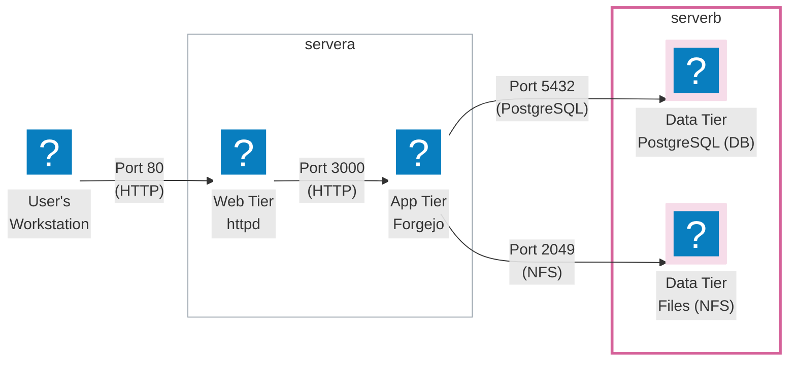

# The Data Tier

## Where an application keeps what it cannot lose

---
horizontal: center
vertical: center
---

# The Data Tier in the Architecture

The database and Forgejo's files, both on `serverb`

---
layout: center
---

# What Is Data?

## Everything the application stores persistently after installation

An application's data is also called its <AccentText>state</AccentText>

---
layout: two-cols-header
vertical: center
horizontal: center
listSpacing: padded
---

# Forgejo Stores Data in Two Places

::left::

<IconGrid>
<IconGridItem icon="data-base">

**In the database**

</IconGridItem>
</IconGrid>

- User Accounts
- Admin and User Settings
- Issues, pull requests, and comments

::right::

<IconGrid>
<IconGridItem icon="folder">

**In the files**

</IconGridItem>
</IconGrid>

- Repositories: the code and its history
- Uploaded attachments
- Avatars

---
horizontal: center
vertical: center
---

# Designing a Data Tier

<IconGrid>
<IconGridItem icon="data-backup">

**Backups** you can restore

</IconGridItem>
<IconGridItem icon="replicate">

**Resiliency** when hardware fails

</IconGridItem>
<IconGridItem icon="growth">

**Capacity** for the data to grow

</IconGridItem>
<IconGridItem icon="meter">

**Performance** under load

</IconGridItem>
<IconGridItem icon="locked">

**Access** for the app tier only

</IconGridItem>
</IconGrid>

---
horizontal: center
vertical: center
---

# What Makes a Backup Useful

<IconGrid>
<IconGridItem icon="send-alt">

Kept off the host it protects

</IconGridItem>
<IconGridItem icon="time">

Taken automatically on a schedule

</IconGridItem>
<IconGridItem icon="version">

Several versions kept

</IconGridItem>
<IconGridItem icon="task-complete">

Tested by restoring it

</IconGridItem>
</IconGrid>

Operate Forgejo does the first three, in the last section

---
layout: two-cols-header
vertical: center
horizontal: center
listSpacing: padded
---

# Resiliency

Keeping the data available when hardware fails

::left::

<IconGrid>
<IconGridItem icon="vmdk-disk">

**When a disk fails**

</IconGridItem>
</IconGrid>

- **RAID 1** mirrors the data on two disks
- The other disk keeps working

::right::

<IconGrid>
<IconGridItem icon="bare-metal-server">

**When a server fails**

</IconGridItem>
</IconGrid>

- **Replication** copies to a standby server
- The standby is ready to take over

::bottom::

Neither is a backup: a deleted repository is deleted on every copy at once

---
vertical: center
---

# This Week's Data Tier

| Consideration | In Build the Data Tier                   | Weeks      |
|---------------|------------------------------------------|------------|
| Capacity      | A partition and two logical volumes      | 10 and 11  |
| Performance   | The `throughput-performance` profile     | 5          |
| Access        | The firewall opens PostgreSQL and NFS    | 7          |
| Access        | Only `servera` may connect or mount      | 13 and 15  |
| Access        | SELinux labels on the new volumes        | 6          |
| Backups       | In Operate Forgejo, nightly to `servera` | 2 to 6     |
| Resiliency    | None: a single point of failure          | Not taught |
