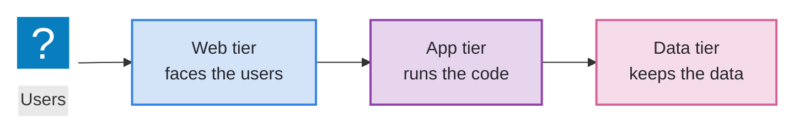
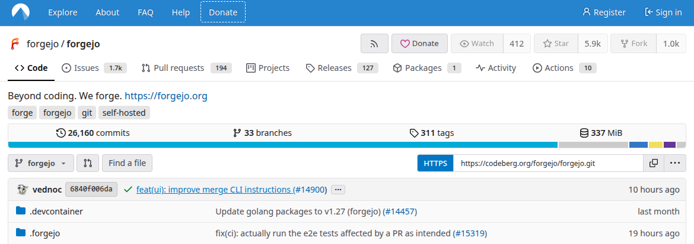
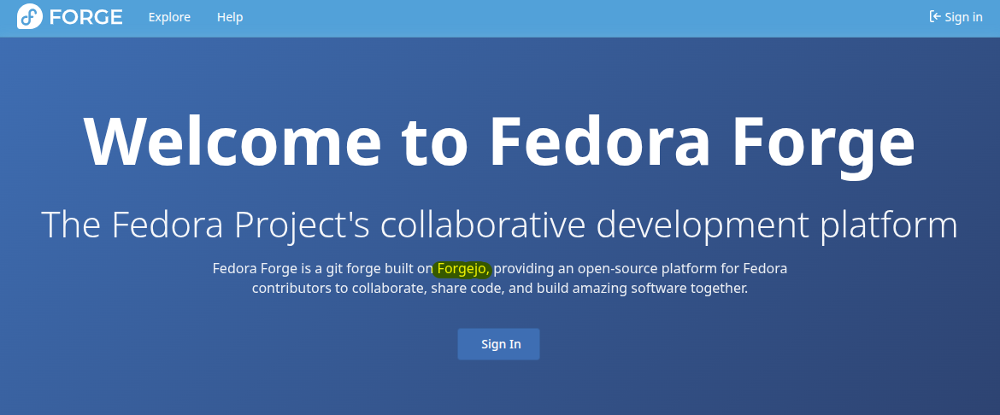
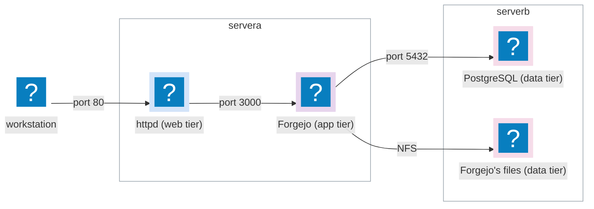

# Final Review

## Self-Hosting Forgejo

---

# What Is Self-Hosting?

## Running applications on hardware you control

---
layout: two-cols-header
vertical: center
horizontal: center
listSpacing: padded
---

# What Is Self-Hosting?

::left::

<IconGrid>
<IconGridItem icon="cloud">

**Hosted service**, such as <AccentText>GitHub</AccentText>

</IconGridItem>
</IconGrid>

- **Someone else** runs it
- **They** keep your data
- **They** set the rules

::right::

<IconGrid>
<IconGridItem icon="home">

**Self-hosted**, such as <AccentText>Forgejo</AccentText>

</IconGridItem>
</IconGrid>

- **You** run it on your own servers
- **You** keep your data
- **You** do the administration

---
horizontal: center
vertical: center
---

# Home Labs

<IconGrid>
<IconGridItem icon="virtual-machine">

Spare hardware or virtual machines

</IconGridItem>
<IconGridItem icon="application">

Services you run for yourself

</IconGridItem>
<IconGridItem icon="debug">

A safe place to break things

</IconGridItem>
<IconGridItem icon="education">

Skills that carry over to work

</IconGridItem>
<IconGridItem icon="view-off">

Keeps your data private

</IconGridItem>
</IconGrid>

---
horizontal: center
vertical: center
---

# N-Tier Architecture

Each tier talks only to its neighbors

---

# Why Separate the Tiers

<IconGrid>
<IconGridItem icon="security">

Only the web tier accepts user connections

</IconGridItem>
<IconGridItem icon="locked">

Each tier is secured for its own job

</IconGridItem>
<IconGridItem icon="renew">

Update or replace one tier at a time

</IconGridItem>
<IconGridItem icon="search">

A failure stays in its own tier

</IconGridItem>
</IconGrid>

---
horizontal: center
---

# What Is Forgejo?

Pronounced <AccentText>for-JEH-yo</AccentText>, from the Esperanto word for forge

---
layout: two-cols-header
vertical: center
---

# Forgejo in Use

::left::

Codeberg hosts Forgejo's own code on Forgejo

::right::

The Fedora Project's forge is built on Forgejo

---
horizontal: center
vertical: center
---

# This Week's Architecture

Only port 80 is open to other hosts; Forgejo's files are automounted from `serverb`

---
vertical: center
---

# Built in Four Exercises

| Exercise            | Hosts                | Reviews weeks             |
|---------------------|----------------------|---------------------------|
| Build the Data Tier | serverb              | 1, 4 to 7, 10, 11, and 13 |
| Build the App Tier  | servera              | 13 and 14                 |
| Build the Web Tier  | workstation, servera | 5 to 7 and 14             |
| Operate Forgejo     | serverb, servera     | 2 to 6                    |

Each one starts where the last one ended
