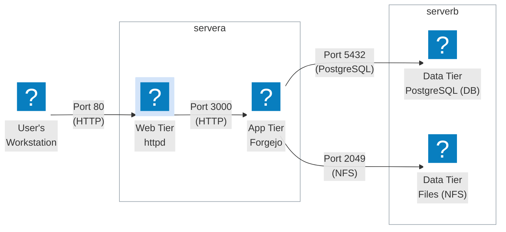

# The Web Tier

## Where users reach the application

---
horizontal: center
vertical: center
---

# The Web Tier in the Architecture



httpd on `servera`, in front of Forgejo

---
horizontal: center
vertical: center
---

# Why a Reverse Proxy

Forgejo's own web server is made to run Forgejo, not to face the network

<IconGrid>
<IconGridItem icon="security">

**Hardened** to face the network

</IconGridItem>
<IconGridItem icon="login">

**One way in** for every user

</IconGridItem>
<IconGridItem icon="port-input">

**Port 80**, which needs root

</IconGridItem>
<IconGridItem icon="catalog">

**Logging** of every request

</IconGridItem>
<IconGridItem icon="certificate">

**Encryption** with HTTPS

</IconGridItem>
</IconGrid>

---

# Only Port 80 Is Open

Forgejo listens on port 3000, but the firewall opens only `http`

<TerminalWindow title="student@workstation:~">

```bash-session
student@workstation:~$ curl git.lab.example.com:3000
curl: (7) Failed to connect to git.lab.example.com port 3000 after 0 ms: Could not connect to server
student@workstation:~$ curl -s git.lab.example.com | grep '<title>'
	<title>Forgejo: Beyond coding. We forge.</title>
```

</TerminalWindow>

Every request reaches Forgejo through httpd

---

# The Proxy Configuration

- A file of its own: `/etc/httpd/conf.d/forgejo.conf`
- Three lines from Forgejo's documentation for Apache

<TextExplainer
  :lines="[
    'ProxyPreserveHost On',
    'AllowEncodedSlashes NoDecode',
    'ProxyPass / http://127.0.0.1:3000/ nocanon',
  ]"
  :steps="[
    { line: 1, explanation: 'Pass on the name the browser asked for, git.lab.example.com' },
    { line: 2, explanation: 'Accept encoded slashes in paths, and leave them encoded' },
    { line: 3, text: 'ProxyPass', explanation: 'Forward requests to another web server' },
    { line: 3, text: '/', occurrence: 1, explanation: 'Every path on this site' },
    { line: 3, text: 'http://127.0.0.1:3000/', explanation: 'Forgejo, on servera\'s own loopback address' },
    { line: 3, text: 'nocanon', explanation: 'Pass each path on as it came, encoded characters included' },
  ]"
/>

---

# SELinux Blocks the Proxy

httpd answers with 503: SELinux will not let it connect to port 3000

<TerminalWindow title="student@servera:~">

```bash-session
student@servera:~$ curl -s localhost | grep '<title>'
<title>503 Service Unavailable</title>
```

</TerminalWindow>

```text [sealert -a /var/log/audit/audit.log (abridged)]
SELinux is preventing /usr/sbin/httpd from name_connect access on the tcp_socket port 3000.
...output omitted...
Then you must tell SELinux about this by enabling the 'httpd_can_network_connect' boolean.

Do
setsebool -P httpd_can_network_connect 1
```

`setsebool -P httpd_can_network_connect on` lets httpd connect

---
vertical: center
---

# This Week's Web Tier

| Reason     | In Build the Web Tier                             | Weeks      |
|------------|---------------------------------------------------|------------|
| Hardened   | httpd forwards each request to Forgejo            | 5 and 15   |
| Hardened   | SELinux confines httpd; a boolean lets it connect | 6 and 15   |
| One way in | The firewall opens only `http`                    | 7          |
| Port 80    | httpd on port 80, Forgejo on 3000                 | 5 and 15   |
| Logging    | httpd's access log, searched in Operate Forgejo   | 5 and 15   |
| Encryption | None: plain HTTP in the lab                       | Not taught |

---
layout: exercise
---

# Build the Web Tier

::goal::

Serve Forgejo at `http://git.lab.example.com` through httpd on `servera`

::environment::

**Hosts:** `workstation` and `servera`

**Prerequisite exercise:** Build the App Tier

::workflow::

1. Name `servera` `git.lab.example.com` on `workstation`
2. Install httpd on `servera` and reverse proxy it to Forgejo
3. Start httpd and open the firewall for `http`
4. Use `sealert` to figure out why the reverse proxy fails
5. Let httpd connect to Forgejo and test from `workstation`

---
layout: exercise
variant: recording
---

<script setup>
import castUrl from "./exercises/build-the-web-tier-exercise.cast?url";
</script>

# Build the Web Tier

::recording::

<AsciinemaPlayer
    :src="castUrl"
    label="Screen recording of the instructor adding git.lab.example.com for servera to workstation's /etc/hosts; installing httpd on servera and writing /etc/httpd/conf.d/forgejo.conf with the three reverse proxy lines; starting httpd and opening the firewall for http; getting 503, installing setroubleshoot-server, and finding with sealert that SELinux denied httpd's connection to port 3000; enabling httpd_can_network_connect; and getting Forgejo's page from servera and, by name, from workstation."
/>

::resources::

<a href="../resources/build-the-web-tier-exercise.html" target="_blank" rel="noopener noreferrer" aria-label="Read the written Build the Web Tier exercise in a new tab">Written exercise</a>
