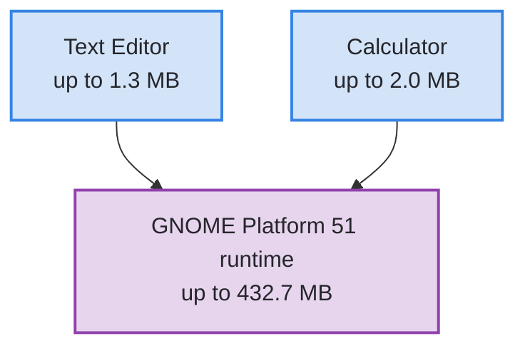
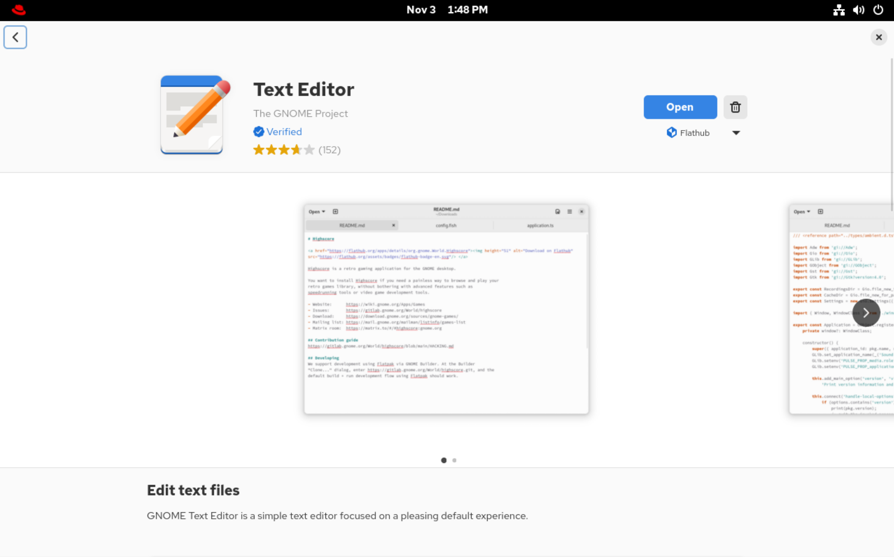

# Installing and Updating Applications by Using Flatpak

---
vertical: center
---

# Why Flatpak? Newer Desktop Applications

RHEL favors stable, tested versions; desktop applications release faster upstream

| Application | RHEL 10 RPM  | Flathub |
| ----------- | ------------ | ------- |
| Text Editor | 47.3         | 51.0    |
| Calculator  | 46.1         | 51.1    |
| Firefox     | 128.8.0esr   | 159.0   |
| Wireshark   | 4.4.2        | 4.6.9   |

Versions from `rpm -q NAME` and `flatpak remote-info flathub ID` on `workstation`, November 2026

For a desktop application, newer means <AccentText>new features and bug fixes sooner</AccentText>

---
vertical: center
---

# Why Flatpak? No `sudo` Needed

Any user can install a Flatpak **for themselves**

<IconGrid
  :items="[
    { icon: 'package', caption: 'The app brings everything it needs' },
    { icon: 'home', caption: 'Installs under ~/.local/share/flatpak' },
    { icon: 'user-multiple', caption: 'Other users see no change' },
    { icon: 'locked', caption: 'dnf needs root: it changes the whole system' },
  ]"
/>

<Callout>

RHCSA tasks ask for this: install an application so only one user can use it

</Callout>

---

# RPM or Flatpak?

|                          | RPM                                            | Flatpak                                  |
| ------------------------ | ---------------------------------------------- | ---------------------------------------- |
| **Best for**             | System software, services, command-line tools  | Desktop applications                     |
| **Comes from**           | RHEL repositories, with `dnf`                  | Remotes such as Flathub, with `flatpak`  |
| **Installs for**         | Everyone; needs `root`                         | One user, or everyone                    |
| **Libraries**            | Shared from the system                         | Bundled, plus a shared runtime           |
| **Supported by Red Hat** | Yes                                            | Not from Flathub                         |

Rule of thumb: a desktop application, <AccentText>Flatpak</AccentText>; everything else, <AccentText>RPM</AccentText>

---
layout: two-cols-header
leftWidth: 45
---

# Applications and Runtimes

A Flatpak application runs on a **runtime**, a shared set of libraries

::left::



::right::

- The runtime downloads once and serves every app built on it
- A second app on the same runtime installs in seconds
- A fix to the runtime reaches every app on it
- Each app runs in a **sandbox** and reaches only what its permissions allow

::bottom::

<Callout>

Flathub's Wireshark has no network permission, so it opens saved captures but cannot capture packets

</Callout>

---

# Remotes

Flatpak installs from **remotes**, repositories of applications and runtimes

<TerminalWindow title="student@workstation:~">

```bash-session
student@workstation:~$ flatpak remotes
Name Options
rhel system,oci,no-gpg-verify
```

</TerminalWindow>

- `rhel` is Red Hat's remote; it needs a Red Hat login, so this course does not use it
- **Flathub**, at flathub.org, is the largest community remote; Red Hat does not support its applications

---

# Add a Remote

`flatpak remote-add` adds a remote; `--user` adds it to your own installation

<TextExplainer
  :lines="[
    'student@workstation:~$ flatpak remote-add --user --if-not-exists flathub \\',
    '    https://dl.flathub.org/repo/flathub.flatpakrepo',
    'student@workstation:~$ flatpak remotes',
    'Name    Options',
    'rhel    system,oci,no-gpg-verify',
    'flathub user',
  ]"
  :steps="[
    { line: 1, text: '--user', explanation: 'For you alone, so no sudo' },
    { line: 1, text: '--if-not-exists', explanation: 'Safe to run twice' },
    { line: 1, text: 'flathub', explanation: 'The name you choose for the remote' },
    { line: 2, text: 'https://dl.flathub.org/repo/flathub.flatpakrepo', explanation: 'A .flatpakrepo file that describes the remote' },
    { line: 6, explanation: 'Added to your user installation' },
  ]"
/>

Without `--user`, `flatpak` changes the system installation, which needs an administrator's authorization

---

# Find an Application

`flatpak search` matches names, descriptions, and IDs in every remote you have

<TerminalWindow title="student@workstation:~">

```bash-session {3}
student@workstation:~$ flatpak search "text editor"
Name              Description                                       Application ID           Version Branch Remotes
Text Editor       Edit text files                                   org.gnome.TextEditor     51.0    stable flathub
Micro Text Editor A modern and intuitive terminal-based text editor io.github.zyedidia.micro 2.0.15  stable flathub
```

</TerminalWindow>

- Later commands take the **application ID**, in reverse-DNS form: `org.gnome.TextEditor`
- `flatpak remote-ls --app flathub` lists every application in a remote

---

# Install an Application

<v-switch at="1">

<template #0>

The app needs a runtime, and `flatpak install` offers to add it

<TerminalWindow title="student@workstation:~" :rows="12">

```bash-session {3,4}
student@workstation:~$ flatpak install --user flathub org.gnome.TextEditor
Looking for matches…
Required runtime for org.gnome.TextEditor/x86_64/stable (runtime/org.gnome.Platform/x86_64/51) found in remote flathub
Do you want to install it? [Y/n]: y

org.gnome.TextEditor permissions:
    ipc       fallback-x11       wayland      dri      file access [1]      dbus access [2]

    [1] host, xdg-run/gvfs, xdg-run/gvfsd
    [2] org.freedesktop.FileManager1, org.gtk.vfs.*
```

</TerminalWindow>

</template>

<template #1>

The permissions are everything the app's sandbox can reach

<TerminalWindow title="student@workstation:~" :rows="12">

```bash-session {6-10}
student@workstation:~$ flatpak install --user flathub org.gnome.TextEditor
Looking for matches…
Required runtime for org.gnome.TextEditor/x86_64/stable (runtime/org.gnome.Platform/x86_64/51) found in remote flathub
Do you want to install it? [Y/n]: y

org.gnome.TextEditor permissions:
    ipc       fallback-x11       wayland      dri      file access [1]      dbus access [2]

    [1] host, xdg-run/gvfs, xdg-run/gvfsd
    [2] org.freedesktop.FileManager1, org.gtk.vfs.*
```

</TerminalWindow>

</template>

<template #2>

Then every ref it will download, and one last question

<TerminalWindow title="student@workstation:~" :rows="12">

```bash-session {12}
student@workstation:~$ flatpak install --user flathub org.gnome.TextEditor
...output omitted...
        ID                                            Branch             Op        Remote         Download
 1.     org.freedesktop.Platform.GL.default           26.08              i         flathub        < 150.5 MB
 2.     org.freedesktop.Platform.GL.default           26.08-extra        i         flathub        < 150.5 MB
 3.     org.freedesktop.Platform.codecs-extra         26.08-extra        i         flathub         < 15.7 MB
 4.     org.gnome.Platform.Locale                     51                 i         flathub        < 391.7 MB (partial)
 5.     org.gnome.Platform                            51                 i         flathub        < 432.7 MB
 6.     org.gnome.TextEditor.Locale                   stable             i         flathub        < 554.8 kB (partial)
 7.     org.gnome.TextEditor                          stable             i         flathub          < 1.3 MB

Proceed with these changes to the user installation? [Y/n]: y
```

</TerminalWindow>

</template>

<template #3>

Each ref gets a ✓ as it installs; add `-y` to answer every question with yes

<TerminalWindow title="student@workstation:~" :rows="12">

```bash-session {4-10}
student@workstation:~$ flatpak install --user flathub org.gnome.TextEditor
...output omitted...
        ID                                            Branch             Op        Remote         Download
 1. [✓] org.freedesktop.Platform.GL.default           26.08              i         flathub        149.4 MB / 150.5 MB
 2. [✓] org.freedesktop.Platform.GL.default           26.08-extra        i         flathub         28.9 MB / 150.5 MB
 3. [✓] org.freedesktop.Platform.codecs-extra         26.08-extra        i         flathub         15.6 MB / 15.7 MB
 4. [✓] org.gnome.Platform.Locale                     51                 i         flathub         18.7 kB / 391.7 MB
 5. [✓] org.gnome.Platform                            51                 i         flathub        371.0 MB / 432.7 MB
 6. [✓] org.gnome.TextEditor.Locale                   stable             i         flathub          5.8 kB / 554.8 kB
 7. [✓] org.gnome.TextEditor                          stable             i         flathub          1.1 MB / 1.3 MB

Installation complete.
```

</TerminalWindow>

</template>

</v-switch>

---
layout: exercise
---

# Install a Flatpak Application

::goal::

Install a newer Firefox for `student` alone, without `sudo`

::environment::

**Host:** `workstation`, as `student`

::workflow::

1. Check the version of the Firefox RPM
2. Add Flathub for yourself only
3. Find Firefox's application ID
4. Start installing Firefox in your user installation, and leave it running

---
layout: exercise
variant: recording
---

<script setup>
import castUrl from "./exercises/install-a-flatpak-application-exercise.cast?url";
</script>

# Install a Flatpak Application

::recording::

<AsciinemaPlayer
    :src="castUrl"
    label="Screen recording of the instructor checking the Firefox RPM's version with rpm -q on workstation, listing the remotes with flatpak remotes, adding Flathub to student's own installation with flatpak remote-add --user and listing the remotes again, searching with flatpak search to find Firefox's application ID, org.mozilla.firefox, and installing Flathub's Firefox for student alone with flatpak install --user -y, which brings seven refs, its runtime among them, and ends with Installation complete."
/>

::resources::

<a href="../resources/install-a-flatpak-application-exercise.html" target="_blank" rel="noopener noreferrer" aria-label="Read the written Install a Flatpak Application exercise in a new tab">Written exercise</a>

---

# List and Inspect

<v-switch at="1">

<template #0>

A second app on the same runtime downloads only itself

<TerminalWindow title="student@workstation:~" :rows="17">

```bash-session {10,11}
student@workstation:~$ flatpak install --user -y flathub org.gnome.Calculator
Looking for matches…

org.gnome.Calculator permissions:
    ipc    network    fallback-x11    wayland    dri


        ID                                    Branch           Op          Remote           Download
 1. [✓] org.gnome.Calculator.Locale           stable           i           flathub          8.3 kB / 1.7 MB
 2. [✓] org.gnome.Calculator                  stable           i           flathub          1.1 MB / 2.0 MB

Installation complete.
```

</TerminalWindow>

</template>

<template #1>

`flatpak list` shows runtimes too; `--app` shows applications only

<TerminalWindow title="student@workstation:~" :rows="17">

```bash-session {3-5,7}
student@workstation:~$ flatpak list
Name                                    Application ID                          Version   Branch        Installation
Mesa                                    org.freedesktop.Platform.GL.default     26.2.5    26.08         user
Mesa (Extra)                            org.freedesktop.Platform.GL.default     26.2.5    26.08-extra   user
Codecs Extra Extension                  org.freedesktop.Platform.codecs-extra             26.08-extra   user
Calculator                              org.gnome.Calculator                    51.1      stable        user
GNOME Application Platform version 51   org.gnome.Platform                                51            user
Text Editor                             org.gnome.TextEditor                    51.0      stable        user
student@workstation:~$ flatpak list --app
Name               Application ID             Version       Branch       Installation
Calculator         org.gnome.Calculator       51.1          stable       user
Text Editor        org.gnome.TextEditor       51.0          stable       user
```

</TerminalWindow>

</template>

<template #2>

`flatpak info` shows where an app came from and what it runs on

<TerminalWindow title="student@workstation:~" :rows="17">

```bash-session {11,13,15}
student@workstation:~$ flatpak info org.gnome.TextEditor

Text Editor - Edit text files

          ID: org.gnome.TextEditor
         Ref: app/org.gnome.TextEditor/x86_64/stable
        Arch: x86_64
      Branch: stable
     Version: 51.0
     License: GPL-3.0-or-later
      Origin: flathub
  Collection: org.flathub.Stable
Installation: user
   Installed: 2.4 MB
     Runtime: org.gnome.Platform/x86_64/51
         Sdk: org.gnome.Sdk/x86_64/51
...output omitted...
```

</TerminalWindow>

</template>

</v-switch>

---

# Run and Update

An installed application appears in **Activities** like any other, or run it by ID

```bash
flatpak run org.gnome.TextEditor
```

Running it creates its data directory, `~/.var/app/org.gnome.TextEditor`

<TerminalWindow title="student@workstation:~">

```bash-session
student@workstation:~$ flatpak update --user
Looking for updates…

Nothing to do.
```

</TerminalWindow>

`flatpak update --user` updates every application and runtime you installed, as soon as Flathub publishes them

---

# Remove an Application

<v-switch at="1">

<template #0>

`flatpak uninstall` lists what it will remove and asks first

<TerminalWindow title="student@workstation:~" :rows="11">

```bash-session {8}
student@workstation:~$ flatpak uninstall --user --delete-data org.gnome.TextEditor


        ID                                  Branch         Op
 1.     org.gnome.TextEditor                stable         r
 2.     org.gnome.TextEditor.Locale         stable         r

Proceed with these changes to the user installation? [Y/n]: y
```

</TerminalWindow>

</template>

<template #1>

`--delete-data` also removes the app's data in `~/.var/app`

<TerminalWindow title="student@workstation:~" :rows="11">

```bash-session {9}
student@workstation:~$ flatpak uninstall --user --delete-data org.gnome.TextEditor


        ID                                  Branch         Op
 1. [-] org.gnome.TextEditor                stable         r
 2. [-] org.gnome.TextEditor.Locale         stable         r

Uninstall complete.
Delete data for org.gnome.TextEditor? [y/n]: y
```

</TerminalWindow>

</template>

<template #2>

`--unused` removes runtimes no installed app needs; Calculator still needs GNOME Platform 51

<TerminalWindow title="student@workstation:~" :rows="11">

```bash-session {10,11}
student@workstation:~$ flatpak uninstall --user --delete-data org.gnome.TextEditor


        ID                                  Branch         Op
 1. [-] org.gnome.TextEditor                stable         r
 2. [-] org.gnome.TextEditor.Locale         stable         r

Uninstall complete.
Delete data for org.gnome.TextEditor? [y/n]: y
student@workstation:~$ flatpak uninstall --user --unused
Nothing unused to uninstall
```

</TerminalWindow>

</template>

</v-switch>

---

# Remove a Remote

Delete a remote and Flatpak offers to remove everything you installed from it

<TerminalWindow title="student@workstation:~">

```bash-session {2,12}
student@workstation:~$ flatpak remote-delete --user flathub
The following refs are installed from remote 'flathub':

   1) runtime/org.gnome.Platform/x86_64/51
   2) runtime/org.gnome.Platform.Locale/x86_64/51
   3) runtime/org.freedesktop.Platform.GL.default/x86_64/26.08
   4) app/org.gnome.Calculator/x86_64/stable
   5) runtime/org.freedesktop.Platform.codecs-extra/x86_64/26.08-extra
   6) runtime/org.gnome.Calculator.Locale/x86_64/stable
   7) runtime/org.freedesktop.Platform.GL.default/x86_64/26.08-extra

Remove them? [y/n]: y
...output omitted...
```

</TerminalWindow>

`flatpak remote-modify --user --disable NAME` turns a remote off instead, without removing what you installed

---
vertical: center
---

# Flatpak Commands

```bash
flatpak remotes                               # List remotes
flatpak remote-add --user NAME URL            # Add a remote for yourself
flatpak search WORD                           # Search every remote
flatpak install --user REMOTE ID              # Install an application for yourself
flatpak list --app                            # List installed applications
flatpak info ID                               # Show an application's details
flatpak run ID                                # Run an application
flatpak update --user                         # Update everything you installed
flatpak uninstall --user --delete-data ID     # Remove an application and its data
flatpak uninstall --user --unused             # Remove runtimes nothing needs
flatpak remote-modify --user --disable NAME   # Turn a remote off
flatpak remote-delete --user NAME             # Remove a remote
```

---
layout: two-cols-header
leftWidth: 60
---

# GNOME Software

GNOME Software installs Flatpaks and RPMs from one window

::left::



::right::

1. Search for the application
2. Choose its source, such as Flathub, and click **Install**
3. Remove it with the trash button on its page

::bottom::

With Flathub added with `--user`, Software installs into your user installation too

---
layout: two-cols-header
leftWidth: 60
---

# GNOME Software: Repositories

Flatpak remotes and RPM repositories in one dialog, each with a switch to turn it on or off

::left::


::right::

1. Open the main menu
2. Choose **Software Repositories**
3. Turn a remote on or off with its switch

Flathub is a **User Installation** remote; `rhel` is a **System Installation** one

---
layout: exercise
---

# Inspect and Remove a Flatpak Application

::goal::

Confirm the new Firefox is yours alone, then remove it

::environment::

**Host:** `workstation`, as `student`

**Prerequisite exercise:** Install a Flatpak Application

::workflow::

1. Confirm the installation finished
2. Compare the Flatpak's version with the RPM's
3. Confirm the installation is yours alone
4. Launch Firefox from Activities
5. Find Firefox in GNOME Software
6. Remove Firefox with its data, then its unused runtimes and the remote

---
layout: exercise
variant: recording
---

<script setup>
import castUrl from "./exercises/inspect-and-remove-a-flatpak-application-exercise.cast?url";
</script>

# Inspect and Remove a Flatpak Application

::recording::

<AsciinemaPlayer
    :src="castUrl"
    label="Screen recording of the instructor confirming with flatpak list --app that Firefox is installed for student, comparing the RPM's version from rpm -q with the Flatpak's from flatpak info, showing with sudo flatpak list --app that root sees no Firefox, passing over the Activities and GNOME Software steps that students do in the VM window, then removing Firefox and its data with flatpak uninstall --user -y --delete-data, its unused runtimes with flatpak uninstall --user -y --unused, and Flathub with flatpak remote-delete --user, until flatpak remotes lists rhel alone."
/>

::resources::

<a href="../resources/inspect-and-remove-a-flatpak-application-exercise.html" target="_blank" rel="noopener noreferrer" aria-label="Read the written Inspect and Remove a Flatpak Application exercise in a new tab">Written exercise</a>
