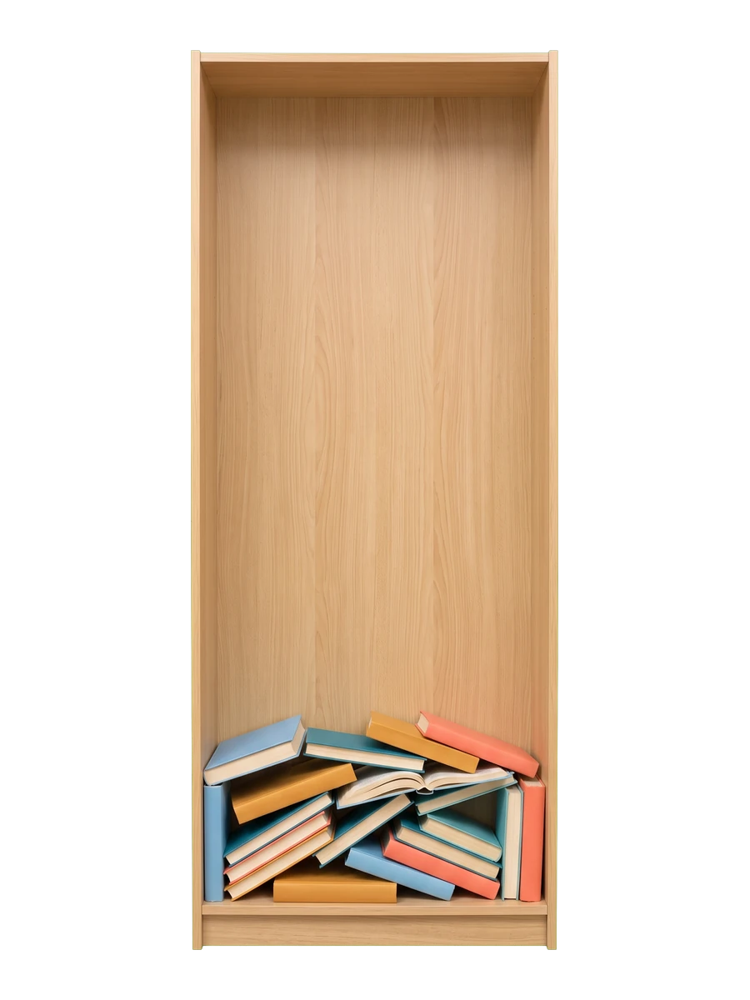
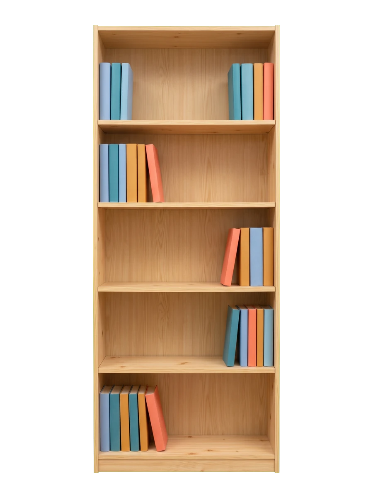

# File Systems

---
layout: two-cols-header
---

# File Systems

A file system controls how files are stored, like shelves in a bookcase

::left::



::right::

<v-click>



</v-click>

---
layout: two-cols-header
leftWidth: 60
---

# File Systems

::left::

| File system | Notes                          |
|-------------|--------------------------------|
| **XFS**     | Red Hat default                |
| **ext4**    | Long-standing Linux standard   |
| **Btrfs**   | Copy-on-write, snapshots       |
| **ZFS**     | File system and volume manager |

<Callout>
Red Hat recommends XFS
</Callout>

::right::


---

# XFS vs ext4

Both are <AccentText>journaling</AccentText> file systems, so both recover quickly after a crash

|                     | XFS                | ext4                 |
|---------------------|--------------------|----------------------|
| Largest file system | 1024 TiB           | 50 TiB               |
| Grow                | Only while mounted | Mounted or unmounted |
| Shrink              | Never              | Only while unmounted |
| Create with         | `mkfs.xfs`         | `mkfs.ext4`          |

---
---

# Create an XFS File System

<v-switch at="1">

<template #0>

Format `/dev/sdb1` with XFS

<TerminalWindow title="root@servera:~">

```bash-session
root@servera:~# mkfs.xfs /dev/sdb1
meta-data=/dev/sdb1              isize=512    agcount=4, agsize=65472 blks
...output omitted...
data     =                       bsize=4096   blocks=261888, imaxpct=25
         =                       sunit=0      swidth=0 blks
naming   =version 2              bsize=4096   ascii-ci=0, ftype=1, parent=0
log      =internal log           bsize=4096   blocks=16384, version=2
         =                       sectsz=512   sunit=0 blks, lazy-count=1
realtime =none                   extsz=4096   blocks=0, rtextents=0
Discarding blocks...Done.
```

</TerminalWindow>

<Callout title="Format the partition, not the disk">

File systems should be created on a <AccentText>partition</AccentText> (`sdb1`) not a disk (`sdb`)

</Callout>


</template>

<template #1>

Verify: `lsblk -fp` shows the file system type and its UUID

<TerminalWindow title="root@servera:~">

```bash-session
root@servera:~# lsblk -fp /dev/sdb
NAME        FSTYPE FSVER LABEL UUID                                 FSAVAIL FSUSE% MOUNTPOINTS
/dev/sdb
├─/dev/sdb1 xfs                6bb0dab6-7866-42ce-986b-7d6c73c0bb48
└─/dev/sdb2
```

</TerminalWindow>

The `xfs` typed into `parted` only set the partition type. `mkfs.xfs` created the file system.

</template>

</v-switch>

---
---

# Create an ext4 File System

<v-switch at="1">

<template #0>

Format `/dev/sdb2` with ext4

<TerminalWindow title="root@servera:~">

```bash-session
root@servera:~# mkfs.ext4 /dev/sdb2
mke2fs 1.47.1 (20-May-2024)
Discarding device blocks: done
Creating filesystem with 262144 4k blocks and 65536 inodes
Filesystem UUID: 0039b3e0-6751-40a6-8fd7-e4311b20b09a
Superblock backups stored on blocks:
        32768, 98304, 163840, 229376

Allocating group tables: done
Writing inode tables: done
Creating journal (8192 blocks): done
Writing superblocks and filesystem accounting information: done
```

</TerminalWindow>

</template>

<template #1>

Verify: both partitions now have a file system

<TerminalWindow title="root@servera:~">

```bash-session
root@servera:~# lsblk -fp /dev/sdb
NAME        FSTYPE FSVER LABEL UUID                                 FSAVAIL FSUSE% MOUNTPOINTS
/dev/sdb
├─/dev/sdb1 xfs                6bb0dab6-7866-42ce-986b-7d6c73c0bb48
└─/dev/sdb2 ext4   1.0         0039b3e0-6751-40a6-8fd7-e4311b20b09a
```

</TerminalWindow>

</template>

</v-switch>

---
layout: exercise
---

# Create File Systems on `/dev/sdb`

::goal::

Put an XFS and an ext4 file system on the two GPT partitions

::environment::

**Host:** `servera`

**Prerequisite exercise:** Create Two GPT Partitions

::workflow::

1. Inspect `/dev/sdb`
2. Create an XFS file system on `/dev/sdb1`
3. Create an ext4 file system on `/dev/sdb2`
4. Verify the file systems

---
layout: exercise
variant: recording
---

<script setup>
import castUrl from "./exercises/create-file-systems-exercise.cast?url";
</script>

# Create File Systems on `/dev/sdb`

::recording::

<AsciinemaPlayer
    :src="castUrl"
    label="Screen recording of the instructor checking that the two GPT partitions on /dev/sdb have no file systems, running mkfs.xfs on /dev/sdb1 and mkfs.ext4 on /dev/sdb2, and verifying with lsblk that each partition now reports its file system type and a UUID."
/>

::resources::

<a href="../resources/create-file-systems-exercise.html" target="_blank" rel="noopener noreferrer" aria-label="Read the written Create File Systems on /dev/sdb exercise in a new tab">Written exercise</a>
