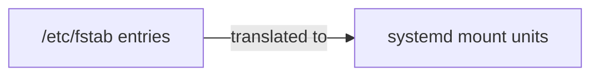

# Mounting File Systems

---
layout: center
---

# `mount` reads like `cp`

| Command | From         | To           |
|---------|--------------|--------------|
| `cp`    | `/etc/hosts` | `/tmp/hosts` |
| `mount` | `/dev/sdb1`  | `/mnt/data`  |

---

# Mount File System Temporarily: Step 1

A file system must be <AccentText>mounted</AccentText> on a directory before you can use it

That directory is called the <AccentText>mount point</AccentText>

The `/mnt` directory is there for temporary mounts

Create the mount point

<TerminalWindow title="root@servera:~">

```bash-session
root@servera:~# mkdir /mnt/data
root@servera:~#
```

</TerminalWindow>

---

# Mount File System Temporarily: Step 2

`mount` attaches the file system to the mount point

The mount is <AccentText>temporary</AccentText>: after a reboot, the file system is no longer mounted

<TextExplainer
  :lines="['mount /dev/sdb1 /mnt/data']"
  :steps="[
    { text: '/dev/sdb1', explanation: 'The file system' },
    { text: '/mnt/data', explanation: 'The mount point' },
  ]"
/>

Temporary mounts can use the device file (`/dev/sdb1`); persistent mounts should use the UUID

---

# Mount File System Temporarily: Step 3

Verify: `lsblk -fp` now fills in FSAVAIL, FSUSE%, and MOUNTPOINTS for `sdb1`

<TerminalWindow title="root@servera:~">

```bash-session
root@servera:~# lsblk -fp /dev/sdb
NAME        FSTYPE FSVER LABEL UUID                                 FSAVAIL FSUSE% MOUNTPOINTS
/dev/sdb
├─/dev/sdb1 xfs                6bb0dab6-7866-42ce-986b-7d6c73c0bb48  908.3M     5% /mnt/data
└─/dev/sdb2 ext4   1.0         0039b3e0-6751-40a6-8fd7-e4311b20b09a
root@servera:~# mount | grep /mnt/data
/dev/sdb1 on /mnt/data type xfs (rw,relatime,seclabel,attr2,inode64,logbufs=8,logbsize=32k,noquota)
```

</TerminalWindow>

---

# Mount File System Temporarily: Step 4

Unmount with `umount`

The command is <AccentText>u</AccentText>mount, not <AccentText>un</AccentText>mount

<TerminalWindow title="root@servera:~">

```bash-session
root@servera:~# umount /mnt/data
root@servera:~#
```

</TerminalWindow>

---
layout: exercise
---

# Temporarily Mount an XFS File System

::goal::

Mount a file system by hand, then unmount it

::environment::

**Host:** `servera`

**Prerequisite exercise:** Create File Systems

::workflow::

1. Inspect `/dev/sdb`
2. Create the mount point `/mnt/records`
3. Temporarily mount `/dev/sdb1` on `/mnt/records`
4. Verify the mount
5. Unmount `/dev/sdb1`
6. Verify it is unmounted

---
layout: exercise
variant: recording
---

<script setup>
import castUrl from "./exercises/temporarily-mount-xfs-exercise.cast?url";
</script>

# Temporarily Mount an XFS File System

::recording::

<AsciinemaPlayer
    :src="castUrl"
    label="Screen recording of the instructor creating /mnt/records, mounting /dev/sdb1 on it, confirming the mount with lsblk and with mount piped to grep, unmounting it with umount, and confirming that grep no longer finds it."
/>

::resources::

<a href="../resources/temporarily-mount-xfs-exercise.html" target="_blank" rel="noopener noreferrer" aria-label="Read the written Temporarily Mount an XFS File System exercise in a new tab">Written exercise</a>

---

# Mount File System Persistently

The file system table, `/etc/fstab`: F-stab or FS-tab, you decide!

Each line defines a file system to mount at boot

```text [/etc/fstab on servera (excerpt, header comment added)]
# device                                   mount point  type  options   dump  fsck
UUID=272f9185-dbd2-41e7-a89d-773b25bebbe9  /            xfs   defaults  0     0
UUID=0bc02b5b-10ec-4b8d-9bc7-327ab7da926e  /boot        xfs   defaults  0     0
UUID=c0d07a5b-5662-4366-a797-9474a1ae9c44  none         swap  defaults  0     0
```



---

# The Six Fields

Each line has six fields, separated by whitespace

<TextExplainer
  size="sm"
  :lines="['UUID=6bb0dab6-7866-42ce-986b-7d6c73c0bb48 /data xfs defaults 0 0']"
  :steps="[
    { text: 'UUID=6bb0dab6-7866-42ce-986b-7d6c73c0bb48', explanation: 'Device: the file system to mount, named by its UUID' },
    { text: '/data', explanation: 'Mount point: the directory to mount it on' },
    { text: 'xfs', explanation: 'Type: the file system type' },
    { text: 'defaults', explanation: 'Options: defaults is the standard set of mount options' },
    { text: '0', occurrence: 3, explanation: 'Dump: 0 skips the obsolete dump backup tool' },
    { text: '0', occurrence: 4, explanation: 'fsck: 0 skips the file system check at boot' },
  ]"
/>

---

# Fields of an `/etc/fstab` Entry

```text
UUID=6bb0dab6-7866-42ce-986b-7d6c73c0bb48 /data xfs defaults 0 0
```

| Field               | Example             | Description                               |
|---------------------|---------------------|-------------------------------------------|
| **1 - Device**      | `UUID=6bb0dab6-...` | The file system to mount (use the UUID)   |
| **2 - Mount point** | `/data`             | The directory to mount it on              |
| **3 - Type**        | `xfs`               | The file system type                      |
| **4 - Options**     | `defaults`          | Mount options, such as `ro` or `noexec`   |
| **5 - Dump**        | `0`                 | Back up with `dump`? `0` is no (obsolete) |
| **6 - fsck**        | `0`                 | Check at boot? `0` is no (rarely used)    |

---
vertical: start
---

# Add an Entry to `/etc/fstab`

<v-switch at="1">

<template #0>

Create the mount point, then append the UUID instead of typing it

<TerminalWindow title="root@servera:~">

```bash-session
root@servera:~# mkdir /data
root@servera:~# lsblk -no UUID /dev/sdb1 >> /etc/fstab
root@servera:~# tail -1 /etc/fstab
6bb0dab6-7866-42ce-986b-7d6c73c0bb48
```

</TerminalWindow>

<Callout type="warning" title="Use >>, not >">

`>` replaces all of `/etc/fstab` with this one line, erasing the entries for `/`, `/boot`, and swap. `>>` appends.

</Callout>

</template>

<template #1>

Finish the line in `vim`: `G` to the last line, `I` to add `UUID=` in front, `A` to add the other fields

<TerminalWindow title="root@servera:~">

```bash-session
root@servera:~# vim /etc/fstab
root@servera:~# tail -1 /etc/fstab
UUID=6bb0dab6-7866-42ce-986b-7d6c73c0bb48 /data xfs defaults 0 0
```

</TerminalWindow>

</template>

</v-switch>

---

# Systemd Mount Units

`/etc/fstab` entries become systemd mount units, so reload systemd after every edit, then mount every entry

<TerminalWindow title="root@servera:~" :rows="12">

````md magic-move
```bash-session
root@servera:~# systemctl daemon-reload
root@servera:~#
```
```bash-session
root@servera:~# systemctl daemon-reload
root@servera:~# mount -av
/                        : ignored
/boot                    : already mounted
none                     : ignored
/mnt/dvd                 : already mounted
mount: /data does not contain SELinux labels.
       You just mounted a file system that supports labels which does not
       contain labels, onto an SELinux box. It is likely that confined
       applications will generate AVC messages and not be allowed access to
       this file system.  For more details see restorecon(8) and mount(8).
/data                    : successfully mounted
```
````

</TerminalWindow>

<div v-click="1">

A new file system has no SELinux labels yet; `restorecon -R /data` adds them

</div>

---
listSpacing: padded
---

# Best Practices

- Use the UUID, not the device file
  - Device names such as `/dev/sdb1` can change between reboots; it is rare, but it happens
  - The UUID belongs to the file system, so it stays the same
- Always test before rebooting
  - `findmnt --verify` checks `/etc/fstab` without mounting anything
  - `mount -av` mounts every entry that is not mounted yet

<Callout type="warning">

A broken `/etc/fstab` can stop the system from booting

</Callout>

---
layout: exercise
---

# Persistently Mount an XFS File System

::goal::

Mount a file system at every boot

::environment::

**Host:** `servera`

**Prerequisite exercise:** Create File Systems

::workflow::

1. Inspect `/dev/sdb`
2. Create the mount point `/records`
3. Persistently mount `/dev/sdb1` on `/records`
4. Test with `mount -av`
5. Reboot and verify

---
layout: exercise
variant: recording
---

<script setup>
import castUrl from "./exercises/persistently-mount-xfs-exercise.cast?url";
</script>

# Persistently Mount an XFS File System

::recording::

<AsciinemaPlayer
    :src="castUrl"
    label="Screen recording of the instructor creating /records, appending the UUID of /dev/sdb1 to /etc/fstab with lsblk, completing the line in vim with the /records mount point, xfs, and defaults, reloading systemd, testing with mount -av and its expected SELinux warning, labeling the file system with restorecon, then rebooting servera and confirming that /records is mounted again."
/>

::resources::

<a href="../resources/persistently-mount-xfs-exercise.html" target="_blank" rel="noopener noreferrer" aria-label="Read the written Persistently Mount an XFS File System exercise in a new tab">Written exercise</a>
