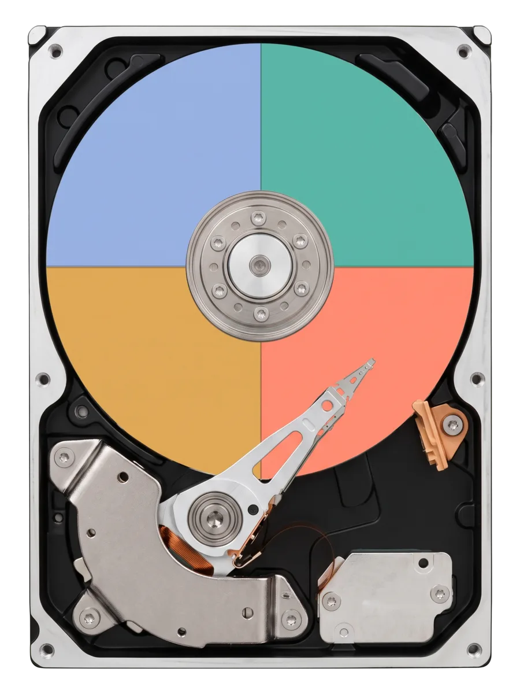
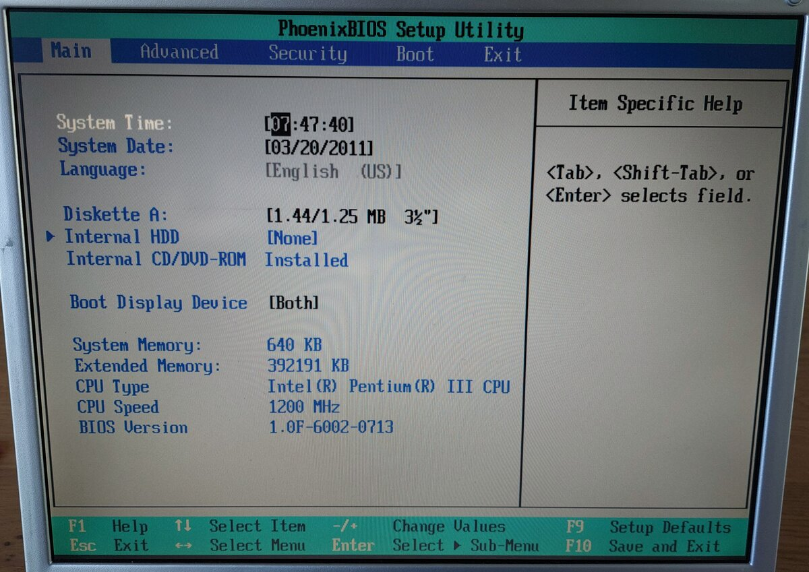
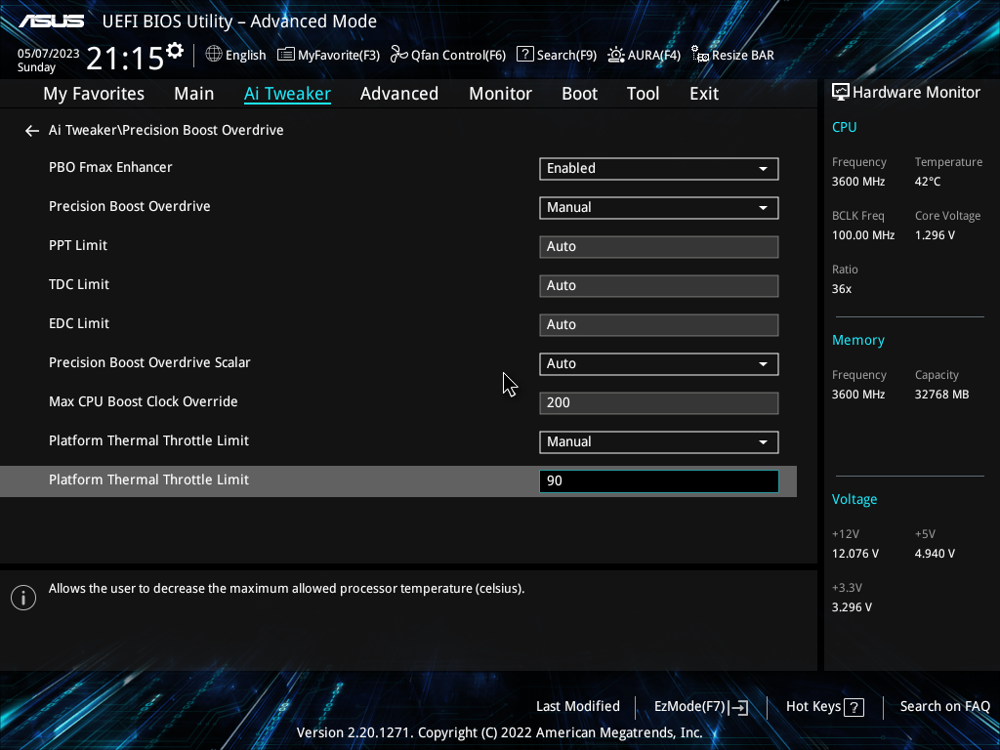
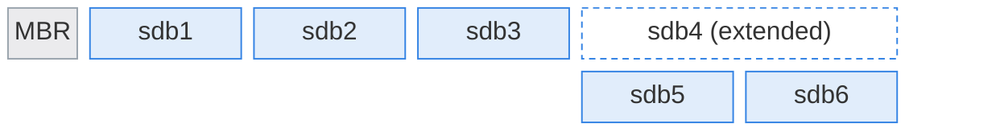
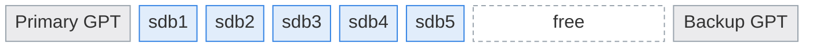

# Partitions

---

# Storage Device Names

The Linux kernel gives each storage device a file

| Disk type                                       | Device         | First partition  |
|-------------------------------------------------|----------------|------------------|
| SCSI, SATA, and USB disks, and VirtualBox disks | `/dev/sda`     | `/dev/sda1`      |
| Virtual disks in KVM virtual machines           | `/dev/vda`     | `/dev/vda1`      |
| NVMe solid-state drives                         | `/dev/nvme0n1` | `/dev/nvme0n1p1` |

The letter counts disks: `sda` is the first disk, `sdb` is the second disk, etc. (Except NVMe)


---
layout: two-cols-header
leftWidth: 59
---

# Partitions

::left::

Split a hard drive into sections

<v-click>

### <SuccessText>Pro:</SuccessText> Isolation

- The system will crash if the root (`/`) partition fills up
    - Prevent by putting `/var` on a separate partition
- Keep the OS files separate from user files

</v-click>

<v-click>

### <DangerText>Con:</DangerText> Inflexible

- Plan ahead: partitions are hard to resize later
- Space is wasted when a partition is sized too large

</v-click>

::right::



---
layout: two-cols-header
vertical: start
horizontal: center
---

# Two Partition Types

::left::

## Master Boot Record (MBR)

The older standard

<div class="w-[270px]">



</div>

<div class="text-xs">

Photograph by [Ekrem Canli](https://commons.wikimedia.org/wiki/User:HylgeriaK), cropped, [CC BY-SA 4.0](https://creativecommons.org/licenses/by-sa/4.0/), via [Wikimedia Commons](https://commons.wikimedia.org/wiki/File:Gericom_1st_Supersonic_M6T_BIOS.jpg)

</div>

Used mostly with BIOS firmware

::right::

<v-click>

## GUID Partition Table (GPT)

The modern standard

<div class="w-[270px]">



</div>

<div class="text-xs">

Screenshot by 10kvsgp, [CC BY-SA 4.0](https://creativecommons.org/licenses/by-sa/4.0/), via [Wikimedia Commons](https://commons.wikimedia.org/wiki/File:Precision_Boost_Overdrive_settings.png)

</div>

Used mostly with UEFI firmware

</v-click>

---
horizontal: center
---

# Master Boot Record (MBR)

<IconGrid
  :items="[
    { icon: 'time', caption: 'An older scheme, from 1983' },
    { icon: 'ruler', caption: 'Disks up to 2 TiB' },
    { icon: 'warning-alt', caption: 'One partition table, no copy' },
    { icon: 'chip', caption: 'Used with BIOS firmware' },
    { icon: 'partition-collection', caption: 'Only four primary partitions' },
    { icon: 'add-alt', caption: 'Extended partitions hold more' },
  ]"
/>

---

# Creating 6 Partitions on MBR

Partition 1-3 are <AccentText>Primary</AccentText> partitions

Partition 4 is a <AccentText>Extended</AccentText> partition

The <AccentText>Extended</AccentText> partition can contain several <AccentText>Logical</AccentText> partitions inside



---
horizontal: center
---

# GUID Partition Table (GPT)

<IconGrid
  :items="[
    { icon: 'partition-collection', caption: 'Up to 128 partitions' },
    { icon: 'ruler', caption: 'Disks up to 8 ZiB' },
    { icon: 'copy', caption: 'Two copies of the partition table' },
    { icon: 'chip', caption: 'Works with UEFI firmware' },
    { icon: 'fingerprint-recognition', caption: 'A Globally Unique ID (GUID) for each disk and partition' },
  ]"
/>



---
horizontal: center
---

# Why Two Sets of Units

<IconGrid
  clicks
  :items="[
    { icon: 'data-base', caption: 'Decimal: 1 KB is 1000 bytes, the way drive makers count' },
    { icon: 'chip', caption: 'Binary: 1 KB is 1024 bytes, the power of 2 closest to 1000' },
    { icon: 'warning-alt', caption: 'The same names, KB, MB, and GB, for two different sizes' },
  ]"
/>

<v-click>

In 1998 the binary units got names of their own

| Binary prefix | kibi        | mebi        | gibi        | tebi        |
|---------------|-------------|-------------|-------------|-------------|
| Short for     | kilo binary | mega binary | giga binary | tera binary |
| Symbol        | KiB         | MiB         | GiB         | TiB         |

</v-click>

---
vertical: center
---

# Disk Size Units

| Decimal      |             Bytes | Binary        |             Bytes | Power of 2 |
|--------------|------------------:|---------------|------------------:|-----------:|
| KB, kilobyte |             1,000 | KiB, kibibyte |             1,024 |        2¹⁰ |
| MB, megabyte |         1,000,000 | MiB, mebibyte |         1,048,576 |        2²⁰ |
| GB, gigabyte |     1,000,000,000 | GiB, gibibyte |     1,073,741,824 |        2³⁰ |
| TB, terabyte | 1,000,000,000,000 | TiB, tebibyte | 1,099,511,627,776 |        2⁴⁰ |

---

# Partitioning Tools

`lsblk` lists block devices: every disk, partition, and mount point

<TerminalWindow title="student@servera:~">

```bash-session
student@servera:~$ lsblk -p
NAME                              MAJ:MIN RM  SIZE RO TYPE MOUNTPOINTS
/dev/sda                            8:0    0   10G  0 disk
├─/dev/sda1                         8:1    0    1M  0 part
├─/dev/sda2                         8:2    0    1G  0 part /boot
└─/dev/sda3                         8:3    0    9G  0 part
  ├─/dev/mapper/rhel_servera-root 253:0    0    8G  0 lvm  /
  └─/dev/mapper/rhel_servera-swap 253:1    0    1G  0 lvm  [SWAP]
/dev/sdb                            8:16   0    5G  0 disk
/dev/sdc                            8:32   0    5G  0 disk
/dev/sdd                            8:48   0    5G  0 disk
/dev/sr0                           11:0    1 1024M  0 rom
/dev/sr1                           11:1    1  7.9G  0 rom  /mnt/dvd
```

</TerminalWindow>

---
layout: two-cols-header
listSpacing: padded
---

# Partitioning Tools

`parted`, the partition editor

::left::

- Create and manage partitions
  - Add, delete, and resize
- Supports both MBR (`msdos`) and GPT
- Two modes
  - Interactive mode
  - Command mode

::right::


---

# `parted` Command Mode

Create an MBR partition table and 1 partition in command mode

<TerminalWindow title="root@servera:~" :rows="15">

````md magic-move
```bash-session
root@servera:~# parted /dev/sdb mklabel msdos
Information: You may need to update /etc/fstab.
```
```bash-session
root@servera:~# parted /dev/sdb mklabel msdos
Information: You may need to update /etc/fstab.

root@servera:~# parted /dev/sdb mkpart primary xfs 1MiB 1GiB
Information: You may need to update /etc/fstab.
```
```bash-session
root@servera:~# parted /dev/sdb mklabel msdos
Information: You may need to update /etc/fstab.

root@servera:~# parted /dev/sdb mkpart primary xfs 1MiB 1GiB
Information: You may need to update /etc/fstab.

root@servera:~# parted /dev/sdb print
Model: ATA QEMU HARDDISK (scsi)
Disk /dev/sdb: 5369MB
Sector size (logical/physical): 512B/512B
Partition Table: msdos
Disk Flags:

Number  Start   End     Size    Type     File system  Flags
 1      1049kB  1074MB  1073MB  primary
```
````

</TerminalWindow>

---

# `parted` Interactive Mode

Create an MBR partition table and 1 partition in interactive mode

<TerminalWindow title="root@servera:~" :rows="13">

````md magic-move
```bash-session
root@servera:~# parted /dev/sdb
GNU Parted 3.6
Using /dev/sdb
Welcome to GNU Parted! Type 'help' to view a list of commands.
(parted)
```
```bash-session
root@servera:~# parted /dev/sdb
GNU Parted 3.6
Using /dev/sdb
Welcome to GNU Parted! Type 'help' to view a list of commands.
(parted) mklabel
```
```bash-session
root@servera:~# parted /dev/sdb
GNU Parted 3.6
Using /dev/sdb
Welcome to GNU Parted! Type 'help' to view a list of commands.
(parted) mklabel
New disk label type?
```
```bash-session
root@servera:~# parted /dev/sdb
GNU Parted 3.6
Using /dev/sdb
Welcome to GNU Parted! Type 'help' to view a list of commands.
(parted) mklabel
New disk label type? msdos
```
```bash-session
root@servera:~# parted /dev/sdb
GNU Parted 3.6
Using /dev/sdb
Welcome to GNU Parted! Type 'help' to view a list of commands.
(parted) mklabel
New disk label type? msdos
(parted)
```
```bash-session
root@servera:~# parted /dev/sdb
GNU Parted 3.6
Using /dev/sdb
Welcome to GNU Parted! Type 'help' to view a list of commands.
(parted) mklabel
New disk label type? msdos
(parted) mkpart
```
```bash-session
root@servera:~# parted /dev/sdb
GNU Parted 3.6
Using /dev/sdb
Welcome to GNU Parted! Type 'help' to view a list of commands.
(parted) mklabel
New disk label type? msdos
(parted) mkpart
Partition type?  primary/extended?
```
```bash-session
root@servera:~# parted /dev/sdb
GNU Parted 3.6
Using /dev/sdb
Welcome to GNU Parted! Type 'help' to view a list of commands.
(parted) mklabel
New disk label type? msdos
(parted) mkpart
Partition type?  primary/extended? primary
```
```bash-session
root@servera:~# parted /dev/sdb
GNU Parted 3.6
Using /dev/sdb
Welcome to GNU Parted! Type 'help' to view a list of commands.
(parted) mklabel
New disk label type? msdos
(parted) mkpart
Partition type?  primary/extended? primary
File system type?  [ext2]?
```
```bash-session
root@servera:~# parted /dev/sdb
GNU Parted 3.6
Using /dev/sdb
Welcome to GNU Parted! Type 'help' to view a list of commands.
(parted) mklabel
New disk label type? msdos
(parted) mkpart
Partition type?  primary/extended? primary
File system type?  [ext2]? xfs
```
```bash-session
root@servera:~# parted /dev/sdb
GNU Parted 3.6
Using /dev/sdb
Welcome to GNU Parted! Type 'help' to view a list of commands.
(parted) mklabel
New disk label type? msdos
(parted) mkpart
Partition type?  primary/extended? primary
File system type?  [ext2]? xfs
Start?
```
```bash-session
root@servera:~# parted /dev/sdb
GNU Parted 3.6
Using /dev/sdb
Welcome to GNU Parted! Type 'help' to view a list of commands.
(parted) mklabel
New disk label type? msdos
(parted) mkpart
Partition type?  primary/extended? primary
File system type?  [ext2]? xfs
Start? 1MiB
```
```bash-session
root@servera:~# parted /dev/sdb
GNU Parted 3.6
Using /dev/sdb
Welcome to GNU Parted! Type 'help' to view a list of commands.
(parted) mklabel
New disk label type? msdos
(parted) mkpart
Partition type?  primary/extended? primary
File system type?  [ext2]? xfs
Start? 1MiB
End?
```
```bash-session
root@servera:~# parted /dev/sdb
GNU Parted 3.6
Using /dev/sdb
Welcome to GNU Parted! Type 'help' to view a list of commands.
(parted) mklabel
New disk label type? msdos
(parted) mkpart
Partition type?  primary/extended? primary
File system type?  [ext2]? xfs
Start? 1MiB
End? 1GiB
```
```bash-session
root@servera:~# parted /dev/sdb
GNU Parted 3.6
Using /dev/sdb
Welcome to GNU Parted! Type 'help' to view a list of commands.
(parted) mklabel
New disk label type? msdos
(parted) mkpart
Partition type?  primary/extended? primary
File system type?  [ext2]? xfs
Start? 1MiB
End? 1GiB
(parted)
```
```bash-session
root@servera:~# parted /dev/sdb
GNU Parted 3.6
Using /dev/sdb
Welcome to GNU Parted! Type 'help' to view a list of commands.
(parted) mklabel
New disk label type? msdos
(parted) mkpart
Partition type?  primary/extended? primary
File system type?  [ext2]? xfs
Start? 1MiB
End? 1GiB
(parted) quit
```
```bash-session
root@servera:~# parted /dev/sdb
GNU Parted 3.6
Using /dev/sdb
Welcome to GNU Parted! Type 'help' to view a list of commands.
(parted) mklabel
New disk label type? msdos
(parted) mkpart
Partition type?  primary/extended? primary
File system type?  [ext2]? xfs
Start? 1MiB
End? 1GiB
(parted) quit
Information: You may need to update /etc/fstab.
```
````

</TerminalWindow>

---
layout: exercise
---

# Create Two GPT Partitions on `/dev/sdb`

::goal::

Partition a blank disk with a GPT label

::environment::

**Host:** `servera`

::workflow::

1. Inspect the storage device `/dev/sdb`
2. Create a `gpt` disk label
3. Create two partitions, 1 GiB each
4. Verify the partitions

---
layout: exercise
variant: recording
---

<script setup>
import castUrl from "./exercises/create-two-gpt-partitions-exercise.cast?url";
</script>

# Create Two GPT Partitions on `/dev/sdb`

::recording::

<AsciinemaPlayer
    :src="castUrl"
    label="Screen recording of the instructor inspecting the blank /dev/sdb with lsblk and parted print, creating a gpt disk label in interactive parted, creating two 1 GiB partitions named data1 and data2, and verifying with lsblk that the partitions exist but have no file systems yet."
/>

::resources::

<a href="../resources/create-two-gpt-partitions-exercise.html" target="_blank" rel="noopener noreferrer" aria-label="Read the written Create Two GPT Partitions on /dev/sdb exercise in a new tab">Written exercise</a>

---
layout: exercise
---

# Create Five MBR Partitions on `/dev/sdc`

::goal::

Use an extended partition to get past MBR's four-partition limit

::environment::

**Host:** `servera`

::workflow::

1. Inspect the storage device `/dev/sdc`
2. Create an `msdos` disk label
3. Create three primary partitions, 500 MiB each
4. Create an extended partition in the remaining space
5. Create a 1 GiB logical partition inside it
6. Verify the partitions

---
layout: exercise
variant: recording
---

<script setup>
import castUrl from "./exercises/create-five-mbr-partitions-exercise.cast?url";
</script>

# Create Five MBR Partitions on `/dev/sdc`

::recording::

<AsciinemaPlayer
    :src="castUrl"
    label="Screen recording of the instructor creating an msdos disk label on /dev/sdc in interactive parted, adding three 500 MiB primary partitions, an extended partition across the remaining space, and a 1 GiB logical partition inside it, verifying with lsblk that the logical partition is numbered 5, then wiping the partition table with wipefs."
/>

::resources::

<a href="../resources/create-five-mbr-partitions-exercise.html" target="_blank" rel="noopener noreferrer" aria-label="Read the written Create Five MBR Partitions on /dev/sdc exercise in a new tab">Written exercise</a>
