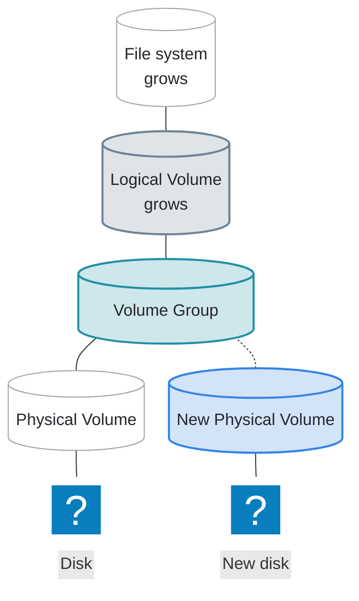

# Extending LVM

---
layout: two-cols-header
leftWidth: 65
---

# How LVM Storage Grows

::left::

Each layer grows with its own command, from the bottom up

| Layer                                                    | Command                                                   |
| -------------------------------------------------------- | --------------------------------------------------------- |
| <AccentText hue="teal">Volume group (VG)</AccentText>    | <AccentText hue="teal" code normal>vgextend</AccentText>  |
| <AccentText hue="slate">Logical volume (LV)</AccentText> | <AccentText hue="slate" code normal>lvextend</AccentText> |
| File system                                              | `xfs_growfs` or `resize2fs`                               |

The file system stays mounted the whole time

::right::



---
vertical: center
---

# Extend a Volume Group

`vgextend` adds a <AccentText hue="blue">PV</AccentText> to an existing <AccentText hue="teal">VG</AccentText>

- Adds capacity without affecting mounted file systems

<TerminalWindow title="root@servera:~">

```bash-session
root@servera:~# pvcreate /dev/sdc1
  Physical volume "/dev/sdc1" successfully created.
root@servera:~# vgextend vg01 /dev/sdc1
  Volume group "vg01" successfully extended
```

</TerminalWindow>

---
---

# Extend a Logical Volume

`lvextend` grows an <AccentText hue="slate">LV</AccentText> into free extents in its <AccentText hue="teal">VG</AccentText>

<TerminalWindow title="root@servera:~">

```bash-session
root@servera:~# lvextend --size +100M /dev/vg01/lv01
  Size of logical volume vg01/lv01 changed from 100.00 MiB (25 extents) to 200.00 MiB (50 extents).
  Logical volume vg01/lv01 successfully resized.
```

</TerminalWindow>

A `+` adds to the current size

| Option                                 | Meaning                         |
| -------------------------------------- | ------------------------------- |
| `-L +500M` / `--size +500M`            | Add 500 MiB to the current size |
| `-l +50` / `--extents +50`             | Add 50 LEs to the current size  |
| `-l +100%FREE` / `--extents +100%FREE` | Add every free extent in the <AccentText hue="teal">VG</AccentText> |

---
layout: two-cols-header
---

# Grow the File System

`lvextend` grows the <AccentText hue="slate">LV</AccentText>, not the file system inside it

::left::

### XFS

`xfs_growfs` takes the mount point

```bash
xfs_growfs /data
```

::right::

### ext4

`resize2fs` takes the device

```bash
resize2fs /dev/vg01/lv01
```

::bottom::

Or do both at once: `--resizefs` runs the right tool for XFS or ext4

```bash
lvextend --resizefs --size +100M /dev/vg01/lv01
```

---

# Aside: Fill a File or Device with `dd`

`dd` copies data from an <AccentText>input file</AccentText> (`if=`) to an <AccentText>output file</AccentText> (`of=`) block by block

`/dev/zero` is a special file that produces endless zeros

<TerminalWindow title="root@servera:~">

```bash-session
root@servera:~# dd if=/dev/zero of=/data/bigfile bs=4k
dd: error writing '/data/bigfile': No space left on device
55334+0 records in
55333+0 records out
226643968 bytes (227 MB, 216 MiB) copied, 0.116624 s, 1.9 GB/s
```

</TerminalWindow>

<Callout>

Without a `count=` limit, `dd` keeps writing until the destination is full

</Callout>

---
layout: exercise
---

# Extend a Logical Volume

::goal::

Grow a full <AccentText hue="slate">logical volume</AccentText> without unmounting it

::environment::

**Host:** `servera`

**Prerequisite exercise:** Create a Logical Volume

::workflow::

1. Fill `lv_data` completely
2. Confirm that further writes fail with "No space left on device"
3. Add a 512 MiB `lvm` partition on `/dev/sdc` to `vg_data` without unmounting `/data`
4. Extend `lv_data` by 200 MiB
5. Grow the XFS file system
6. Confirm that writes to `/data` succeed again

---
layout: exercise
variant: recording
---

<script setup>
import castUrl from "./exercises/extend-logical-volume-exercise.cast?url";
</script>

# Extend a Logical Volume

::recording::

<AsciinemaPlayer
    :src="castUrl"
    label="Screen recording of the instructor filling /data with dd until no space is left, showing that echo can no longer create a file there, adding a 512 MiB lvm partition on /dev/sdc to vg_data with parted, pvcreate, and vgextend, extending lv_data by 200 MiB with lvextend, growing its XFS file system with xfs_growfs, and writing to /data again."
/>

::resources::

<a href="../resources/extend-logical-volume-exercise.html" target="_blank" rel="noopener noreferrer" aria-label="Read the written Extend a Logical Volume exercise in a new tab">Written exercise</a>
