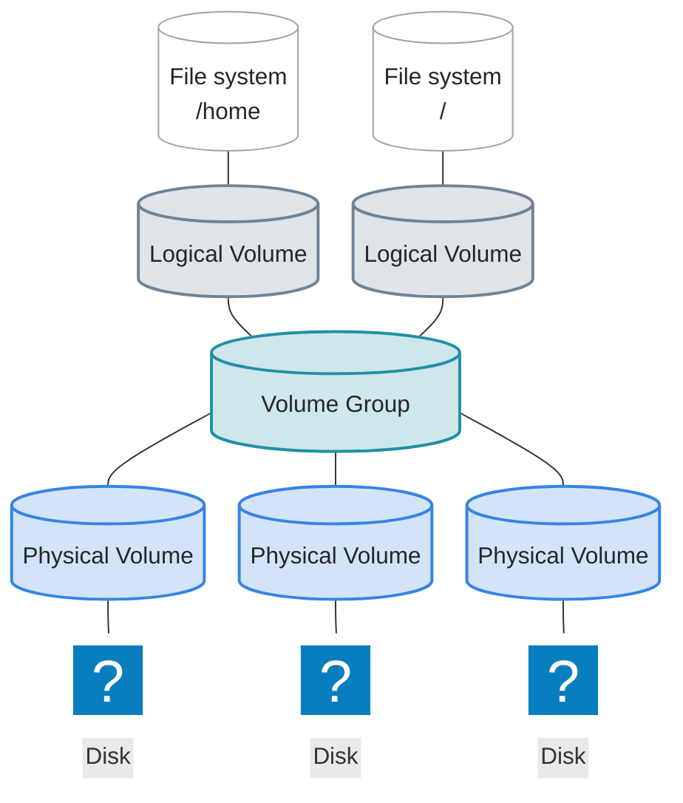

# Logical Volume Manager (LVM)

---
layout: two-cols-header
leftWidth: 60
listSpacing: padded
---

# What Is LVM?

::left::

**Logical Volume Manager** is a storage abstraction layer

### Why use LVM?

- Resize volumes **without downtime**
- **Combine** several disks into one mount point
- **Replace** a failing disk without downtime
- Consistent storage device names across servers

::right::

---
layout: two-cols-header
vertical: center
listSpacing: padded
leftWidth: 60
---

# LVM: Three Layers

::left::

- <AccentText hue="blue">Physical Volume (PV)</AccentText>
    - A storage device initialized for LVM
- <AccentText hue="teal">Volume Group (VG)</AccentText>
    - A storage pool built from one or more <AccentText hue="blue">PVs</AccentText>
- <AccentText hue="slate">Logical Volume (LV)</AccentText>
    - A flexible slice of a <AccentText hue="teal">VG</AccentText> that you format and mount

::right::

---
horizontal: center
---

# LVM Commands

These commands manage each layer in the LVM stack

| Layer                                                    | Create     | Summary | Details     | Remove     |
|----------------------------------------------------------|------------|---------|-------------|------------|
| <AccentText hue="blue">Physical volume (PV)</AccentText> | <AccentText hue="blue" code normal>pvcreate</AccentText> | <AccentText hue="blue" code normal>pvs</AccentText> | <AccentText hue="blue" code normal>pvdisplay</AccentText> | <AccentText hue="blue" code normal>pvremove</AccentText> |
| <AccentText hue="teal">Volume group (VG)</AccentText>    | <AccentText hue="teal" code normal>vgcreate</AccentText> | <AccentText hue="teal" code normal>vgs</AccentText> | <AccentText hue="teal" code normal>vgdisplay</AccentText> | <AccentText hue="teal" code normal>vgremove</AccentText> |
| <AccentText hue="slate">Logical volume (LV)</AccentText> | <AccentText hue="slate" code normal>lvcreate</AccentText> | <AccentText hue="slate" code normal>lvs</AccentText> | <AccentText hue="slate" code normal>lvdisplay</AccentText> | <AccentText hue="slate" code normal>lvremove</AccentText> |

Type <AccentText hue="blue" code>pv</AccentText>, <AccentText hue="teal" code>vg</AccentText>, or <AccentText hue="slate" code>lv</AccentText> and press <kbd>Tab</kbd> twice to list the rest

---
horizontal: center
vertical: center
clicks: 2
---

# LVM Commands

<AccentText hue="blue">Physical Volume</AccentText>

<AccentText hue="teal">Volume Group</AccentText>

<AccentText hue="slate">Logical Volume</AccentText>

Create

Details

Remove

<AccentText hue="blue" code>pv</AccentText><AccentText hue="teal" code>vg</AccentText><AccentText hue="slate" code>lv</AccentText>create

<AccentText hue="blue" code>pv</AccentText><AccentText hue="teal" code>vg</AccentText><AccentText hue="slate" code>lv</AccentText>display

<AccentText hue="blue" code>pv</AccentText><AccentText hue="teal" code>vg</AccentText><AccentText hue="slate" code>lv</AccentText>remove

Physical volumes: pvcreate, pvdisplay, pvremove. Volume groups: vgcreate, vgdisplay, vgremove. Logical volumes: lvcreate, lvdisplay, lvremove. Only the first two letters change.

