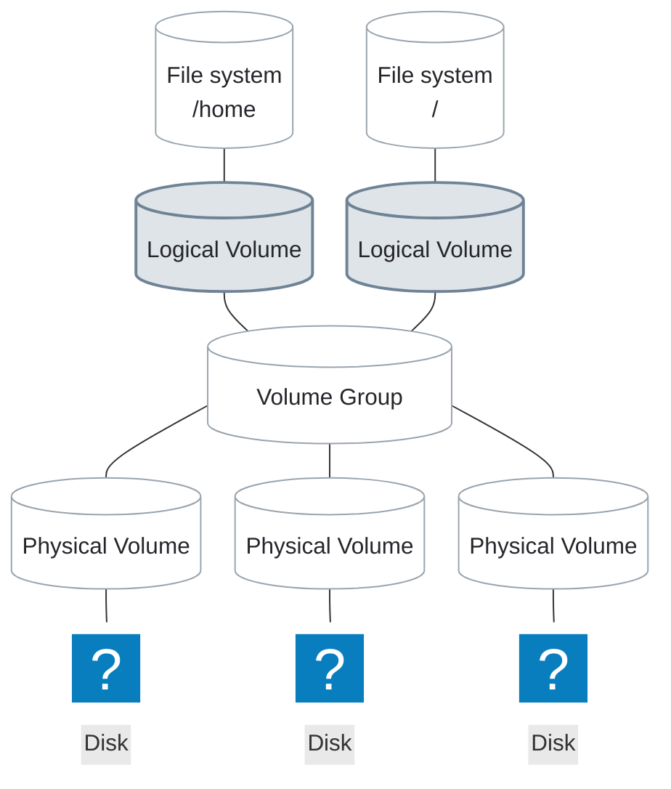

# Logical Volumes

---
layout: two-cols-header
listSpacing: padded
leftWidth: 60
---

# Logical Volumes (LVs)

::left::

<div>

A <AccentText hue="slate">logical volume</AccentText> is a flexible block device

- Created from free physical extents in a <AccentText hue="teal">VG</AccentText>
- The OS sees just another block device
    - Like a partition, a disk, or a RAID device

</div>

<div>

### Why <AccentText hue="slate">LV</AccentText>s are needed

- Size is not bound to one physical disk
    - Made up of physical extents
- Resize **without unmounting**
    - Grow a file system while it is in use

</div>

::right::



---

# Create a Logical Volume

<div>

`lvcreate` creates a <AccentText hue="slate">logical volume</AccentText> from free extents in a <AccentText hue="teal">VG</AccentText>

<TerminalWindow title="root@servera:~">

```bash-session
root@servera:~# lvcreate --name lv01 --size 100M vg01
  Logical volume "lv01" created.
```

</TerminalWindow>

</div>

<div>

Use all the free extents left in the <AccentText hue="teal">VG</AccentText>

<TerminalWindow title="root@servera:~">

```bash-session
root@servera:~# lvcreate --name lv01 --extents 100%FREE vg01
  Logical volume "lv01" created.
```

</TerminalWindow>

</div>

---
---

# Specifying LV Size

A <AccentText hue="slate">LV</AccentText> is made of **logical extents (LEs)**, each mapped to one physical extent in the <AccentText hue="teal">VG</AccentText>

<v-switch at="1">

<template #0>

### `-l` / `--extents` takes a count or percentage of extents

| Option                               | Meaning                                  |
| ------------------------------------ | ---------------------------------------- |
| `-l 32` / `--extents 32`             | Exactly 32 LEs (128 MiB at 4 MiB per PE) |
| `-l 100%FREE` / `--extents 100%FREE` | Every free extent left in the <AccentText hue="teal">VG</AccentText> |

</template>

<template #1>

### `-L` / `--size` takes a size in human-readable units

| Option                    | Meaning         |
| ------------------------- | --------------- |
| `-L 300M` / `--size 300M` | Exactly 300 MiB |
| `-L 2G` / `--size 2G`     | Exactly 2 GiB   |

<Callout>

`M` is MiB and `G` is GiB. LVM rounds a size up to a whole extent, so `--size 10M` makes a 12 MiB <AccentText hue="slate">LV</AccentText>

</Callout>

</template>

</v-switch>

---

# LV Device Paths

LVM creates two equivalent paths for every <AccentText hue="slate">LV</AccentText>

| Path form                   | Example                 |
| --------------------------- | ----------------------- |
| `/dev/vgname/lvname`        | `/dev/vg01/lv01`        |
| `/dev/mapper/vgname-lvname` | `/dev/mapper/vg01-lv01` |

Use either; both link to the same device

<TerminalWindow title="root@servera:~">

```bash-session
root@servera:~# ls -l /dev/vg01/lv01 /dev/mapper/vg01-lv01
lrwxrwxrwx. 1 root root 7 Oct 17 13:18 /dev/mapper/vg01-lv01 -> ../dm-2
lrwxrwxrwx. 1 root root 7 Oct 17 13:18 /dev/vg01/lv01 -> ../dm-2
```

</TerminalWindow>

The path stays the same across reboots, so `/etc/fstab` can use it in place of a UUID

---
vertical: center
---

# Inspect Logical Volumes

`lvs` gives a summary of all <AccentText hue="slate">LV</AccentText>s on the system

<TerminalWindow title="root@servera:~">

```bash-session
root@servera:~# lvs
  LV   VG           Attr       LSize   Pool Origin Data%  Meta%  Move Log Cpy%Sync Convert
  root rhel_servera -wi-ao----  <8.00g
  swap rhel_servera -wi-ao----   1.00g
  lv01 vg01         -wi-a----- 100.00m
```

</TerminalWindow>

---

# Inspect Logical Volumes

`lvdisplay` shows the details of one <AccentText hue="slate">LV</AccentText>

<TerminalWindow title="root@servera:~">

```bash-session {1-6,8,10-11}
root@servera:~# lvdisplay /dev/vg01/lv01
  --- Logical volume ---
  LV Path                /dev/vg01/lv01
  LV Name                lv01
  VG Name                vg01
  LV UUID                AK1yu4-Y96j-pZVZ-b0o2-TiS1-HZOw-MgNyBK
...output omitted...
  LV Status              available
...output omitted...
  LV Size                100.00 MiB
  Current LE             25
...output omitted...
```

</TerminalWindow>

25 logical extents × 4.00 MiB = 100 MiB, taken from the <AccentText hue="teal">VG</AccentText>'s free extents

---
layout: exercise
---

# Create a Logical Volume

::goal::

Carve a <AccentText hue="slate">logical volume</AccentText> from `vg_data` and mount it at boot

::environment::

**Host:** `servera`

**Prerequisite exercise:** Create a Volume Group

::workflow::

1. Create a <AccentText hue="slate">logical volume</AccentText> named `lv_data` using all available space in `vg_data`
2. Format `lv_data` with an XFS file system
3. Persistently mount `lv_data` on `/data`
4. Verify with `lsblk`, `df`, and `lvdisplay`

---
layout: exercise
variant: recording
---

<script setup>
import castUrl from "./exercises/create-logical-volume-exercise.cast?url";
</script>

# Create a Logical Volume

::recording::

<AsciinemaPlayer
    :src="castUrl"
    label="Screen recording of the instructor creating lv_data from all of vg_data with lvcreate --extents 100%FREE, formatting it with mkfs.xfs, adding its line to /etc/fstab in vim, mounting it on /data, and checking it with lsblk, df, and lvdisplay."
/>

::resources::

<a href="../resources/create-logical-volume-exercise.html" target="_blank" rel="noopener noreferrer" aria-label="Read the written Create a Logical Volume exercise in a new tab">Written exercise</a>
