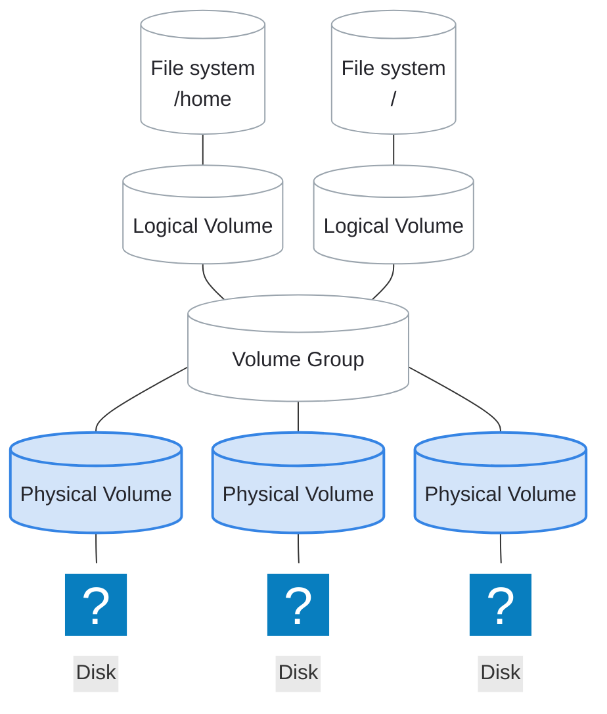

# Physical Volumes

---
layout: two-cols-header
listSpacing: padded
leftWidth: 60
---

# Physical Volumes (PVs)

::left::

<div>

A <AccentText hue="blue">physical volume</AccentText> is a block device initialized for LVM

- A partition, a whole disk, or a RAID device
    - **Recommendation**: <AccentText>Use a partition</AccentText>

</div>

<div>

### Why PVs are needed

- LVM cannot use raw storage directly
- Creating a <AccentText hue="blue">PV</AccentText> gives the device a **UUID**
- Only a <AccentText hue="blue">PV</AccentText> can join a <AccentText hue="teal">volume group</AccentText>

</div>

::right::



---
vertical: start
---

# Prepare a Partition for LVM

The `lvm` flag marks a partition for LVM

<v-switch at="1">

<template #0>

Set the flag in interactive mode (partition 1) or in one command (partition 2)

<TerminalWindow title="root@servera:~">

```bash-session
root@servera:~# parted /dev/sdb
GNU Parted 3.6
Using /dev/sdb
Welcome to GNU Parted! Type 'help' to view a list of commands.
(parted) set
Partition number? 1
Flag to Invert? lvm
New state?  [on]/off? on
(parted) quit
Information: You may need to update /etc/fstab.

root@servera:~# parted /dev/sdb set 2 lvm on
Information: You may need to update /etc/fstab.
```

</TerminalWindow>

</template>

<template #1>

Verify: `print` lists `lvm` in the Flags column

<TerminalWindow title="root@servera:~">

```bash-session
root@servera:~# parted /dev/sdb print
Model: ATA QEMU HARDDISK (scsi)
Disk /dev/sdb: 5369MB
Sector size (logical/physical): 512B/512B
Partition Table: gpt
Disk Flags:

Number  Start   End    Size   File system  Name     Flags
 1      1049kB  268MB  267MB               primary  lvm
 2      268MB   536MB  267MB               primary  lvm
```

</TerminalWindow>

The flag is a label, not a requirement; use it so people and tools can see what the partition holds

</template>

</v-switch>

---

# Initialize a Physical Volume

<div>

`pvcreate` creates a <AccentText hue="blue">physical volume</AccentText>

<TerminalWindow title="root@servera:~">

```bash-session
root@servera:~# pvcreate /dev/sdb1
  Physical volume "/dev/sdb1" successfully created.
```

</TerminalWindow>

</div>

<div>

Create several at once

<TerminalWindow title="root@servera:~">

```bash-session
root@servera:~# pvcreate /dev/sdb1 /dev/sdb2
  Physical volume "/dev/sdb1" successfully created.
  Physical volume "/dev/sdb2" successfully created.
```

</TerminalWindow>

</div>

---
vertical: center
---

# Inspect Physical Volumes

`pvs` gives a summary of all <AccentText hue="blue">PV</AccentText>s on the system

<TerminalWindow title="root@servera:~">

```bash-session
root@servera:~# pvs
  PV         VG           Fmt  Attr PSize   PFree
  /dev/sda3  rhel_servera lvm2 a--   <9.00g      0
  /dev/sdb1               lvm2 ---  255.00m 255.00m
  /dev/sdb2               lvm2 ---  255.00m 255.00m
```

</TerminalWindow>

---

# Inspect Physical Volumes

`pvdisplay` shows the details of one <AccentText hue="blue">PV</AccentText>

<TerminalWindow title="root@servera:~">

```bash-session {all|2-4,6,12|5,7-11}
root@servera:~# pvdisplay /dev/sdb1
  "/dev/sdb1" is a new physical volume of "255.00 MiB"
  --- NEW Physical volume ---
  PV Name               /dev/sdb1
  VG Name
  PV Size               255.00 MiB
  Allocatable           NO
  PE Size               0
  Total PE              0
  Free PE               0
  Allocated PE          0
  PV UUID               fZl8Fh-lwzF-W3f3-33Bu-WcFi-QdDi-1sK8Vl
```

</TerminalWindow>

A <AccentText hue="blue">PV</AccentText> that has not been added to a <AccentText hue="teal">volume group</AccentText> and no extents yet

---
layout: exercise
---

# Initialize a Physical Volume

::goal::

Prepare a partition on a blank disk for LVM

::environment::

**Host:** `servera`

::workflow::

1. Create a 512 MiB GPT partition with the `lvm` flag on `/dev/sdb`
2. Initialize `/dev/sdb1` as a <AccentText hue="blue">physical volume</AccentText>
3. Verify with `pvs` and `pvdisplay`

---
layout: exercise
variant: recording
---

<script setup>
import castUrl from "./exercises/initialize-physical-volume-exercise.cast?url";
</script>

# Initialize a Physical Volume

::recording::

<AsciinemaPlayer
    :src="castUrl"
    label="Screen recording of the instructor listing the disks with lsblk, creating a 512 MiB GPT partition named pv1 on /dev/sdb in parted's interactive mode and setting its lvm flag, initializing /dev/sdb1 as a physical volume with pvcreate, and inspecting it with pvs and pvdisplay."
/>

::resources::

<a href="../resources/initialize-physical-volume-exercise.html" target="_blank" rel="noopener noreferrer" aria-label="Read the written Initialize a Physical Volume exercise in a new tab">Written exercise</a>
