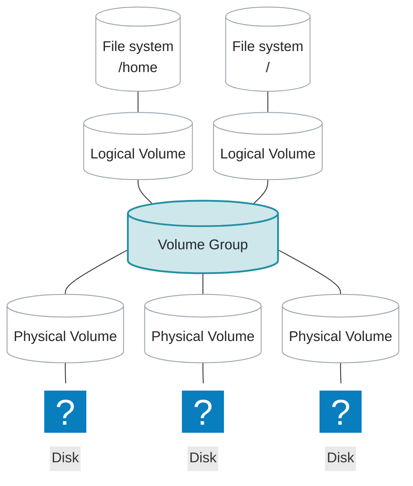

# Volume Groups

---
layout: two-cols-header
listSpacing: padded
leftWidth: 61
---

# Volume Groups (VGs)

::left::

<div>

A <AccentText hue="teal">volume group</AccentText> is a storage pool

- Made of one or more <AccentText hue="blue">physical volumes</AccentText>

</div>

<div>

### Why <AccentText hue="teal">VG</AccentText>s are needed

- Combines <AccentText hue="blue">PV</AccentText>s into one block of storage
- Divides them into chunks called **physical extents (PEs)**
- PE size is set when the <AccentText hue="teal">VG</AccentText> is created
    - 4MiB by default

</div>

::right::



---

# Create a Volume Group

<div>

`vgcreate` pools one or more <AccentText hue="blue">PV</AccentText>s into a <AccentText hue="teal">volume group</AccentText>

<TerminalWindow title="root@servera:~">

```bash-session
root@servera:~# vgcreate vg01 /dev/sdb1
  Volume group "vg01" successfully created
```

</TerminalWindow>

</div>

<div>

Create from several <AccentText hue="blue">PV</AccentText>s

<TerminalWindow title="root@servera:~">

```bash-session
root@servera:~# vgcreate vg01 /dev/sdb1 /dev/sdb2
  Volume group "vg01" successfully created
```

</TerminalWindow>

</div>

---
vertical: center
---

# Inspect Volume Groups

`vgs` gives a summary of all <AccentText hue="teal">VG</AccentText>s on the system

<TerminalWindow title="root@servera:~">

```bash-session
root@servera:~# vgs
  VG           #PV #LV #SN Attr   VSize   VFree
  rhel_servera   1   2   0 wz--n-  <9.00g      0
  vg01           2   0   0 wz--n- 504.00m 504.00m
```

</TerminalWindow>

---

# Inspect Volume Groups

`vgdisplay` shows the details of one <AccentText hue="teal">VG</AccentText>

<TerminalWindow title="root@servera:~">

```bash-session {1-3,5,7-12}
root@servera:~# vgdisplay vg01
  --- Volume group ---
  VG Name               vg01
...output omitted...
  Cur PV                2
...output omitted...
  VG Size               504.00 MiB
  PE Size               4.00 MiB
  Total PE              126
  Alloc PE / Size       0 / 0
  Free  PE / Size       126 / 504.00 MiB
  VG UUID               ysIv1Q-YRzs-yQfO-NG0q-vzzs-u2ol-daWnyc
```

</TerminalWindow>

4.00 MiB × 126 extents = 504 MiB; the free extents are what `lvcreate` can use

---
layout: exercise
---

# Create a Volume Group

::goal::

Pool the new <AccentText hue="blue">physical volume</AccentText> into a <AccentText hue="teal">volume group</AccentText>

::environment::

**Host:** `servera`

**Prerequisite exercise:** Initialize a Physical Volume

::workflow::

1. Create a <AccentText hue="teal">volume group</AccentText> named `vg_data` using `/dev/sdb1`
2. Verify with `vgs` and `vgdisplay`

---
layout: exercise
variant: recording
---

<script setup>
import castUrl from "./exercises/create-volume-group-exercise.cast?url";
</script>

# Create a Volume Group

::recording::

<AsciinemaPlayer
    :src="castUrl"
    label="Screen recording of the instructor creating the volume group vg_data from /dev/sdb1 with vgcreate, then inspecting it with vgs and vgdisplay, which show 508 MiB in 127 free extents."
/>

::resources::

<a href="../resources/create-volume-group-exercise.html" target="_blank" rel="noopener noreferrer" aria-label="Read the written Create a Volume Group exercise in a new tab">Written exercise</a>
