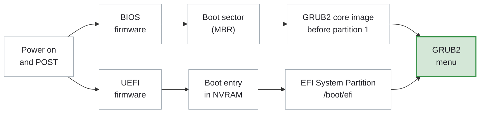
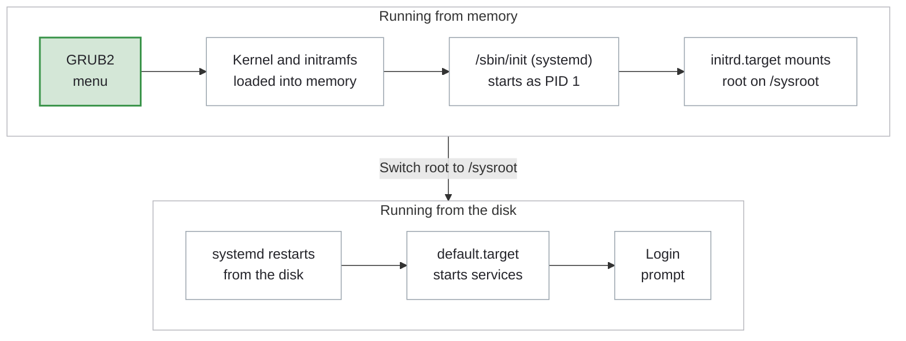

# GRUB2 Boot Loader

---
vertical: center
---

# What Is GRUB2?

The **GRand Unified Bootloader 2** is the boot loader RHEL uses

<IconGrid
  :items="[
    { icon: 'chip', caption: 'Loads the kernel, the heart of the OS' },
    { icon: 'archive', caption: 'Loads the initramfs, a small OS with drivers' },
    { icon: 'parameter', caption: 'Passes arguments to the kernel' },
    { icon: 'list', caption: 'Offers a menu of kernels to boot' },
  ]"
/>

---

# The Boot Process: Firmware to GRUB2



Both paths end at the GRUB2 menu; the lab VMs boot **BIOS**

---

# The Boot Process: GRUB2 to Login



Kernel arguments can change what runs as PID 1 and which target systemd starts

---
layout: two-cols-header
vertical: center
---

# The GRUB2 Boot Menu

::left::

- Lists the installed kernels, newest first
- The default entry starts highlighted
- A countdown boots it automatically

| Key                             | Action                  |
| ------------------------------- | ----------------------- |
| Any key except <kbd>Enter</kbd> | Stop the countdown      |
| Arrow keys                      | Select an entry         |
| <kbd>Enter</kbd>                | Boot the selected entry |
| <kbd>e</kbd>                    | Edit the selected entry |

::right::


---
layout: two-cols-header
vertical: center
---

# Editing a GRUB2 Boot Entry

::left::

1. Press <kbd>e</kbd> on the selected entry
2. Move to the line that starts with `linux`
3. Press <kbd>End</kbd> to reach the end of the line
4. Type a space and the kernel arguments
5. Press <kbd>Ctrl</kbd>+<kbd>X</kbd> to boot

<Callout>

Changes apply to <AccentText>this boot only</AccentText>

</Callout>

::right::


::bottom::

After boot, `cat /proc/cmdline` shows the arguments the running kernel received

---

# Inspect the Default Kernel

<v-switch at="1">

<template #0>

`grubby --default-index` prints the index of the default boot entry

<TerminalWindow title="root@servera:~">

```bash-session
root@servera:~# grubby --default-index
0
```

</TerminalWindow>

Entries are numbered from `0`

</template>

<template #1>

`grubby --info` shows the details of one entry

<TerminalWindow title="root@servera:~">

```bash-session
root@servera:~# grubby --info 0
index=0
kernel="/boot/vmlinuz-6.12.0-55.9.1.el10_0.x86_64"
args="ro crashkernel=2G-64G:256M,64G-:512M resume=UUID=c0d07a5b-5662-4366-a797-9474a1ae9c44
rd.lvm.lv=rhel_servera/root rd.lvm.lv=rhel_servera/swap"
root="/dev/mapper/rhel_servera-root"
initrd="/boot/initramfs-6.12.0-55.9.1.el10_0.x86_64.img"
title="Red Hat Enterprise Linux (6.12.0-55.9.1.el10_0.x86_64) 10.0 (Coughlan)"
id="62e8bf6f19f74c5abba239bffb63fc20-6.12.0-55.9.1.el10_0.x86_64"
```

</TerminalWindow>

</template>

<template #2>

Command substitution combines the two: `$(grubby --default-index)` becomes `0`

<TerminalWindow title="root@servera:~">

```bash-session
root@servera:~# grubby --info $(grubby --default-index)
index=0
kernel="/boot/vmlinuz-6.12.0-55.9.1.el10_0.x86_64"
args="ro crashkernel=2G-64G:256M,64G-:512M resume=UUID=c0d07a5b-5662-4366-a797-9474a1ae9c44
rd.lvm.lv=rhel_servera/root rd.lvm.lv=rhel_servera/swap"
root="/dev/mapper/rhel_servera-root"
initrd="/boot/initramfs-6.12.0-55.9.1.el10_0.x86_64.img"
title="Red Hat Enterprise Linux (6.12.0-55.9.1.el10_0.x86_64) 10.0 (Coughlan)"
id="62e8bf6f19f74c5abba239bffb63fc20-6.12.0-55.9.1.el10_0.x86_64"
```

</TerminalWindow>

</template>

</v-switch>

---

# Change the Default Boot Entry

`grubby --set-default-index` changes which entry GRUB2 boots by default

<TerminalWindow title="root@servera:~">

```bash-session
root@servera:~# grubby --set-default-index 0
The default is /boot/loader/entries/62e8bf6f19f74c5abba239bffb63fc20-6.12.0-55.9.1.el10_0.x86_64.conf
with index 0 and kernel /boot/vmlinuz-6.12.0-55.9.1.el10_0.x86_64
```

</TerminalWindow>

The change persists across reboots; verify with `grubby --default-index`

---

# Get the Default Kernel Path

`grubby --default-kernel` prints the path to the default kernel

<TerminalWindow title="root@servera:~">

```bash-session
root@servera:~# grubby --default-kernel
/boot/vmlinuz-6.12.0-55.9.1.el10_0.x86_64
```

</TerminalWindow>

`--update-kernel` needs a kernel path, and `--default-kernel` provides it

```bash
grubby --update-kernel $(grubby --default-kernel) --args="..."
```

---

# Add a Persistent Kernel Argument

<v-switch at="1">

<template #0>

`grubby --update-kernel` adds arguments to an entry; they persist across reboots

<TerminalWindow title="root@servera:~">

```bash-session
root@servera:~# grubby --update-kernel $(grubby --default-kernel) --args="rhgb quiet"
root@servera:~#
```

</TerminalWindow>

- `rhgb` shows a graphical boot screen when `plymouth` is installed
- `quiet` hides most boot messages

</template>

<template #1>

Verify with `grubby --info`: `rhgb quiet` now ends `args`

<TerminalWindow title="root@servera:~">

```bash-session {4,5}
root@servera:~# grubby --info $(grubby --default-index)
index=0
kernel="/boot/vmlinuz-6.12.0-55.9.1.el10_0.x86_64"
args="ro crashkernel=2G-64G:256M,64G-:512M resume=UUID=c0d07a5b-5662-4366-a797-9474a1ae9c44
rd.lvm.lv=rhel_servera/root rd.lvm.lv=rhel_servera/swap rhgb quiet"
root="/dev/mapper/rhel_servera-root"
initrd="/boot/initramfs-6.12.0-55.9.1.el10_0.x86_64.img"
title="Red Hat Enterprise Linux (6.12.0-55.9.1.el10_0.x86_64) 10.0 (Coughlan)"
id="62e8bf6f19f74c5abba239bffb63fc20-6.12.0-55.9.1.el10_0.x86_64"
```

</TerminalWindow>

</template>

</v-switch>

---

# Remove a Persistent Kernel Argument

<v-switch at="1">

<template #0>

`--remove-args` takes arguments off an entry; the change persists across reboots

<TerminalWindow title="root@servera:~">

```bash-session
root@servera:~# grubby --update-kernel $(grubby --default-kernel) --remove-args="rhgb quiet"
root@servera:~#
```

</TerminalWindow>

</template>

<template #1>

Verify with `grubby --info`: `rhgb quiet` is gone from `args`

<TerminalWindow title="root@servera:~">

```bash-session {4,5}
root@servera:~# grubby --info $(grubby --default-index)
index=0
kernel="/boot/vmlinuz-6.12.0-55.9.1.el10_0.x86_64"
args="ro crashkernel=2G-64G:256M,64G-:512M resume=UUID=c0d07a5b-5662-4366-a797-9474a1ae9c44
rd.lvm.lv=rhel_servera/root rd.lvm.lv=rhel_servera/swap"
root="/dev/mapper/rhel_servera-root"
initrd="/boot/initramfs-6.12.0-55.9.1.el10_0.x86_64.img"
title="Red Hat Enterprise Linux (6.12.0-55.9.1.el10_0.x86_64) 10.0 (Coughlan)"
id="62e8bf6f19f74c5abba239bffb63fc20-6.12.0-55.9.1.el10_0.x86_64"
```

</TerminalWindow>

</template>

</v-switch>

---
vertical: center
---

# The GRUB Environment

GRUB2 keeps a few variables in `/boot/grub2/grubenv` and reads them at every boot

`grub2-editenv` manages them

| Command                         | Action             |
| ------------------------------- | ------------------ |
| `grub2-editenv - list`          | Show the variables |
| `grub2-editenv - set name=value`| Set a variable     |
| `grub2-editenv - unset name`    | Remove a variable  |

The `-` stands for the default file, `/boot/grub2/grubenv`

---
vertical: center
---

# The GRUB Environment

<TextExplainer
  :lines="[
    'root@servera:~# grub2-editenv - list',
    'saved_entry=62e8bf6f19f74c5abba239bffb63fc20-6.12.0-55.9.1.el10_0.x86_64',
    'menu_auto_hide=1',
    'boot_success=1',
    'boot_indeterminate=0',
  ]"
  :steps="[
    { line: 2, explanation: 'The default boot entry, which grubby --set-default-index sets' },
    { line: 3, explanation: '1 hides the menu after a successful boot' },
    { line: 4, explanation: '1 when the last boot succeeded' },
  ]"
/>

---

# `menu_auto_hide`

GRUB2 hides the menu when `menu_auto_hide=1` and the last boot succeeded

Unset it so the menu appears on every boot

<TerminalWindow title="root@servera:~">

```bash-session
root@servera:~# grub2-editenv - unset menu_auto_hide
root@servera:~# grub2-editenv - list
saved_entry=62e8bf6f19f74c5abba239bffb63fc20-6.12.0-55.9.1.el10_0.x86_64
boot_success=1
boot_indeterminate=0
```

</TerminalWindow>

<Callout title="Once per VM">

The setting persists, so each VM needs it only once

</Callout>

---

# `grubby` vs `grub2-editenv`

|                   | `grubby`                                | `grub2-editenv`             |
| ----------------- | --------------------------------------- | --------------------------- |
| **Manages**       | Boot entries and their kernel arguments | GRUB2's environment variables |
| **Stored in**     | `/boot/loader/entries/*.conf`           | `/boot/grub2/grubenv`       |
| **Use for**       | Kernel arguments, the default entry     | Menu behavior               |
| **Example**       | `--args="rhgb quiet"`                   | `menu_auto_hide`            |

`grubby` controls *what* boots; `grub2-editenv` controls *how* the menu behaves

<Callout title="One overlap">

`grubby --set-default-index` stores the default in `grubenv`, as `saved_entry`

</Callout>

---
layout: exercise
---

# Change Kernel Arguments

::goal::

Boot `servera` once with an extra kernel argument, then make it persistent

::environment::

**Host:** `servera`, with its VM console open for the GRUB2 menu

::workflow::

1. Make the GRUB2 menu appear on every boot
2. Boot once with `ipv6.disable=1` added at the GRUB2 menu
3. Confirm the argument with `/proc/cmdline` and `ip -br addr`
4. Reboot without editing and confirm the argument is gone
5. Add `ipv6.disable=1` persistently with `grubby`
6. Reboot and confirm the argument is still there
7. Remove the argument with `grubby`
