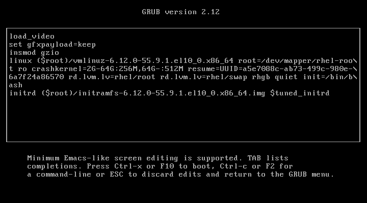

# Recovering Superuser Access

---
vertical: center
---

# When Root Access Is Lost

If the `root` password is unknown or locked, nobody can administer the system

`init=/bin/bash` on the kernel command line starts bash as PID 1 instead of systemd

<IconGrid
  :items="[
    { icon: 'login', caption: 'No login, no password' },
    { icon: 'user-admin', caption: 'A root shell at once' },
    { icon: 'locked', caption: '/ is mounted read-only' },
  ]"
/>

<Callout>

Needs the console, physical or remote, to reach the GRUB2 menu

</Callout>

---

# Aside: Locking an Account

`passwd -l` locks an account by putting `!` in front of its password hash

<TextExplainer
  :lines="[
    'root@servera:~# grep root /etc/shadow',
    'root:$y$j9T$...::0:99999:7:::',
    'root@servera:~# passwd -l root',
    'passwd: password changed.',
    'root@servera:~# grep root /etc/shadow',
    'root:!$y$j9T$...::0:99999:7:::',
    'root@servera:~# passwd -S root',
    'root L never 0 99999 7 -1',
  ]"
  :steps="[
    { line: 2, text: '$y$j9T$...', explanation: 'The hash of the password, shortened here' },
    { line: 6, text: '!', explanation: 'No password can match a hash that starts with !' },
    { line: 8, text: 'L', explanation: 'passwd -S shows L for locked. A new password from passwd writes a fresh hash without the !, and the status reads P' },
  ]"
/>

---
layout: two-cols-header
leftWidth: 45
---

# Edit the GRUB2 Entry

::left::

<v-switch at="1">

<template #0>

**Step 1:** Open the GRUB2 editor

1. Reboot and stop the countdown
2. Press <kbd>e</kbd> to edit the default entry
3. Move to the line that starts with `linux`

</template>

<template #1>

**Step 2:** Clean up the `linux` line

Remove any `console=` options

<Callout type="warning">

Left in place, they can open the shell on a console you cannot reach

</Callout>

</template>

<template #2>

**Step 3:** Append `init=/bin/bash`

Press <kbd>End</kbd>, then type a space and

```text
init=/bin/bash
```

Press <kbd>Ctrl</kbd>+<kbd>X</kbd> to boot

</template>

</v-switch>

::right::



---

# Remount Root Read/Write

The kernel line's `ro` mounts `/` **read-only**, and systemd, which would remount it, never ran

`passwd` must write `/etc/shadow`, so remount first, at the `bash-5.2#` prompt

<TerminalWindow title="servera console">

```bash
mount -o remount,rw /
```

</TerminalWindow>

Verify with `mount | grep root`: look for `rw` in the options

---

# Reset the Root Password

`passwd` with no argument changes the current user's password, and that user is `root`

<TerminalWindow title="servera console">

```text
bash-5.2# passwd
New password:
BAD PASSWORD: The password is shorter than 8 characters
Retype new password:
passwd: password updated successfully
```

</TerminalWindow>

Nothing echoes as you type the password

<Callout>

`root` gets a warning for a short password, but the change still goes through

</Callout>

---

# Trigger SELinux Relabeling

With no SELinux policy loaded, the new `/etc/shadow` from `passwd` gets **no label**

An unlabeled `/etc/shadow` blocks logins once SELinux enforces again

<TerminalWindow title="servera console">

```bash
touch /.autorelabel
```

</TerminalWindow>

Next boot, systemd sees `/.autorelabel`, runs `restorecon` on every file, and reboots

---

# Hand Control to systemd

`reboot` is `systemctl`, which needs systemd, and systemd is not running

`exec` replaces bash with systemd as PID 1, and the boot carries on

<TerminalWindow title="servera console">

```bash
exec /sbin/init
```

</TerminalWindow>

The relabel runs, then the system reboots by itself into a normal boot

<Callout type="warning">

Not `exit`: that ends PID 1 and leaves the kernel without one

</Callout>

---
layout: exercise
---

# Recover Root Access

::goal::

Lock `root` out of `servera`, then get back in by booting with `init=/bin/bash`

::environment::

**Host:** `servera`, with its VM console open

**Prerequisite exercise:** Change Kernel Arguments

::workflow::

1. Lock the `root` account and confirm a console login fails
2. Boot once with `init=/bin/bash` added at the GRUB2 menu
3. Remount the root file system read/write
4. Reset the `root` password
5. Schedule an SELinux relabel
6. Hand control to systemd and wait for the relabel and reboot
7. Log in as `root` at the console
