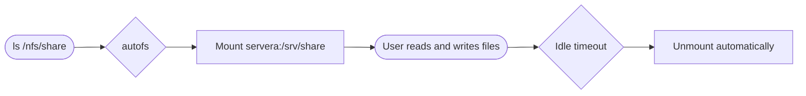
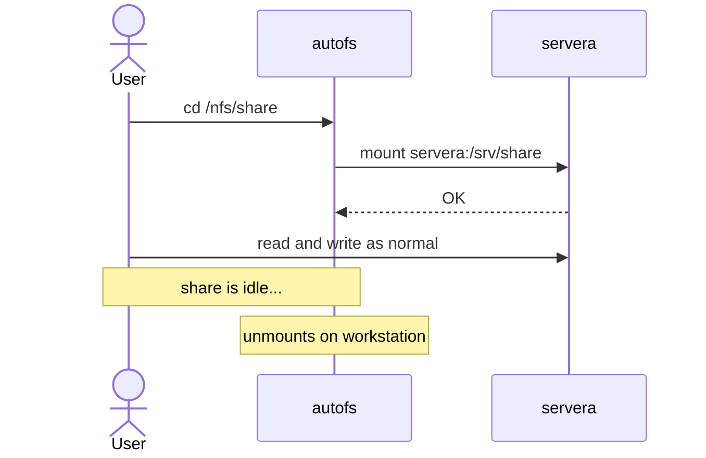

# Automounting with autofs

---
listSpacing: padded
---

# What Is the Automounter?

- `autofs` is a service that manages NFS mounts automatically
- It watches configured directories for access attempts
- When a user enters a watched directory, `autofs` mounts the share **just in time**
- When the share sits idle for a timeout, five minutes by default, `autofs` unmounts it



---
horizontal: center
---

# autofs Mounts on First Access



---
listSpacing: padded
---

# Why Use the Automounter?

- NFS shares mounted through `/etc/fstab` are always mounted
    - Even when no one is using them
- If the NFS server is unreachable at boot, an `/etc/fstab` mount can **delay** the boot
- `autofs` mounts shares **on demand**
- Shares are **unmounted after a timeout** when no longer in use
- Non-root users can trigger an `autofs` mount

---

# Install `autofs`

```bash
dnf install autofs
```

| What    | Name                  | Purpose                                            |
| ------- | --------------------- | -------------------------------------------------- |
| Service | `autofs`              | Monitors mount points and mounts shares on demand  |
| Config  | `/etc/auto.master`    | Default master map; reads `/etc/auto.master.d/`    |
| Config  | `/etc/auto.master.d/` | Recommended place for your master map files        |

---

# The Master Map File

- Lives in `/etc/auto.master.d/` with an `.autofs` extension
- Each line pairs a **base directory** with a **map file**
- The map file holds the mount details; name it `/etc/auto.name` after what it mounts

```text [/etc/auto.master.d/nfs.autofs]
base-directory  map-file
```

| Field            | Meaning                      | Example         |
| ---------------- | ---------------------------- | --------------- |
| `base-directory` | Where `autofs` manages mounts | `/nfs`          |
| `map-file`       | File holding mount details    | `/etc/auto.nfs` |

---

# Direct Maps

- Mount a share at a **fixed, known path**
- The map file gives the full path of the mount point
- The master map uses `/-` as the base directory

```text [/etc/auto.master.d/direct.autofs]
/-  /etc/auto.direct
```

```text [/etc/auto.direct]
/nfs/share  -rw,sync  servera:/srv/share
```

---

# Direct Maps

```text [/etc/auto.direct]
/nfs/share  -rw,sync  servera:/srv/share
```

| Field       | Meaning                                       | Example              |
| ----------- | --------------------------------------------- | -------------------- |
| Mount point | Full path where the share appears             | `/nfs/share`         |
| Options     | Mount options, led by `-`                     | `-rw,sync`           |
| `-fstype=`  | Optional: the type, NFS by default            | `-fstype=nfs4,rw`    |
| Source      | NFS export to mount                           | `servera:/srv/share` |

---

# Enable the `autofs` Service

<v-switch at="1">

<template #0>

`systemctl enable autofs --now` starts the automounter and starts it at every boot

<TerminalWindow title="root@workstation:~">

```bash-session
root@workstation:~# systemctl enable autofs --now
Created symlink '/etc/systemd/system/multi-user.target.wants/autofs.service' → '/usr/lib/systemd/system/autofs.service'.
```

</TerminalWindow>

- The mount point does **not** need to exist; `autofs` creates it
- The share is **not mounted yet**; it mounts the first time the path is used

</template>

<template #1-4>

The first access mounts the share

<TerminalWindow title="root@workstation:~" :rows="10">

````md magic-move {at:2}
```bash-session
root@workstation:~# mount | grep /nfs/share
/etc/auto.direct on /nfs/share type autofs (rw,relatime,fd=12,pgrp=4904,timeout=300,minproto=5,maxproto=5,direct,
pipe_ino=38582)
```
```bash-session {4,5}
root@workstation:~# mount | grep /nfs/share
/etc/auto.direct on /nfs/share type autofs (rw,relatime,fd=12,pgrp=4904,timeout=300,minproto=5,maxproto=5,direct,
pipe_ino=38582)
root@workstation:~# ls /nfs/share
readme.txt
```
```bash-session {6,9-10}
root@workstation:~# mount | grep /nfs/share
/etc/auto.direct on /nfs/share type autofs (rw,relatime,fd=12,pgrp=4904,timeout=300,minproto=5,maxproto=5,direct,
pipe_ino=38582)
root@workstation:~# ls /nfs/share
readme.txt
root@workstation:~# mount | grep /nfs/share
/etc/auto.direct on /nfs/share type autofs (rw,relatime,fd=12,pgrp=4904,timeout=300,minproto=5,maxproto=5,direct,
pipe_ino=38582)
servera:/srv/share on /nfs/share type nfs4 (rw,relatime,sync,vers=4.2,rsize=262144,wsize=262144,namlen=255,hard,
proto=tcp,timeo=600,retrans=2,sec=sys,clientaddr=172.25.250.9,local_lock=none,addr=172.25.250.10)
```
````

</TerminalWindow>

Before: only the `autofs` trigger. After: the trigger and the `nfs4` mount from `servera`

</template>

</v-switch>

---
layout: exercise
---

# Configure a Direct Map

::goal::

Have `workstation` mount a share at a fixed path the first time it is used

::environment::

**Hosts:** `servera` (server), `workstation` (client)

**Prerequisite exercise:** Mount NFS Exports

::workflow::

1. On `servera`, create `/srv/manuals` and export it
2. Reload the exports and verify with `showmount --exports`
3. On `workstation`, install `autofs`
4. Create the master map file in `/etc/auto.master.d/`
5. Create the direct map for `/nfs/manuals`
6. Enable and start the `autofs` service
7. Verify the share is not mounted, then access the mount point
8. Verify the share is now mounted

---
layout: exercise
variant: recording
---

<script setup>
import castUrl from "./exercises/configure-direct-map-exercise.cast?url";
</script>

# Configure a Direct Map

::recording::

<AsciinemaPlayer
    :src="castUrl"
    label="Screen recording of the instructor exporting /srv/manuals from servera and checking it with exportfs and showmount, installing autofs on workstation, writing a master map for a direct map and a direct map for /nfs/manuals, enabling autofs, showing only the autofs trigger with mount, reading a file in /nfs/manuals as student, showing the nfs4 mount that the access created, then removing the maps and the export."
/>

::resources::

<a href="../resources/configure-direct-map-exercise.html" target="_blank" rel="noopener noreferrer" aria-label="Read the written Configure a Direct Map exercise in a new tab">Written exercise</a>

---

# Indirect Maps

- Mount shares in **subdirectories** of a base directory
- The master map names the base directory
- The map file gives each mount point as a **relative name**

```text [/etc/auto.master.d/indirect.autofs]
/nfs  /etc/auto.indirect
```

```text [/etc/auto.indirect]
share  -rw,sync  servera:/srv/share
```

The share mounts at `/nfs/share`; `autofs` creates and removes `share` itself, and hides whatever was already in `/nfs`

---

# Wildcard Maps

- One map entry can cover **every subdirectory** of a server export
- `*` is the key, and `&` repeats the key in the source

```text [/etc/auto.indirect]
*  -rw,sync  servera:/srv/&
```

- Accessing `/nfs/docs` mounts `servera:/srv/docs`
- Accessing `/nfs/data` mounts `servera:/srv/data`
- Each subdirectory mounts **independently**, only when accessed

<Callout>

`servera` must export each requested directory, or a directory above it, or the access fails with "No such file or directory"

</Callout>

---
layout: exercise
---

# Configure an Indirect Map

::goal::

Mount each subdirectory of a share on demand with one map entry

::environment::

**Hosts:** `servera` (server), `workstation` (client)

**Prerequisite exercise:** Configure a Direct Map

::workflow::

1. On `servera`, create `/srv/regions` with `east` and `west` subdirectories and export it
2. Reload the exports and verify with `showmount --exports`
3. On `workstation`, add a master map entry for `/nfs/regions`
4. Create the indirect map file with a wildcard entry
5. Restart the `autofs` service
6. Verify `/nfs/regions` is empty before accessing any subdirectory
7. Access `east` and verify only it is mounted
8. Access `west` and verify both are mounted

---
layout: exercise
variant: recording
---

<script setup>
import castUrl from "./exercises/configure-indirect-map-exercise.cast?url";
</script>

# Configure an Indirect Map

::recording::

<AsciinemaPlayer
    :src="castUrl"
    label="Screen recording of the instructor exporting /srv/regions with east and west subdirectories from servera, adding a master map for /nfs/regions and a wildcard map for servera:/srv/regions/& on workstation, restarting autofs, showing /nfs/regions empty, reading the east file and seeing only east mounted, reading the west file and seeing both mounted, then removing the maps and the export."
/>

::resources::

<a href="../resources/configure-indirect-map-exercise.html" target="_blank" rel="noopener noreferrer" aria-label="Read the written Configure an Indirect Map exercise in a new tab">Written exercise</a>
