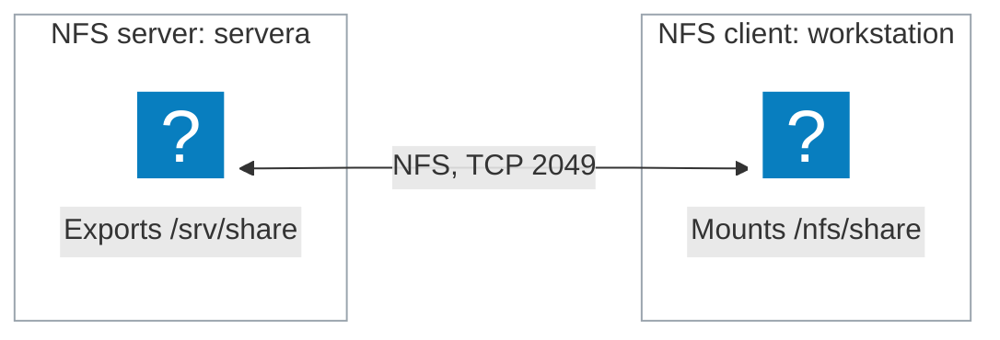

# Network File System

---
vertical: center
---

# What Is Network File System (NFS)?

<IconGrid>
<IconGridItem icon="network-3">

A protocol for sharing directories over a network

</IconGridItem>
<IconGridItem icon="chip">

Built into the Linux kernel

</IconGridItem>
<IconGridItem icon="locked">

Uses native Linux permissions

</IconGridItem>
<IconGridItem icon="folder-shared">

The NFS server exports a directory

</IconGridItem>
<IconGridItem icon="folder-add">

The NFS client mounts it on a local path

</IconGridItem>
<IconGridItem icon="document">

The client reads and writes files normally

</IconGridItem>
</IconGrid>

---
horizontal: center
---

# NFS in the Lab

| Role           | Machine       | Action                                                      |
| -------------- | ------------- | ----------------------------------------------------------- |
| NFS **server** | `servera`     | *Exports* a directory, making it available on the network   |
| NFS **client** | `workstation` | *Mounts* the exported directory on a local path             |
