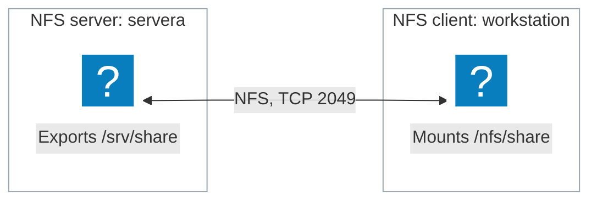

# Network File System

---
vertical: center
---

# What Is Network File System (NFS)?

<IconGrid
  :items="[
    { icon: 'network-3', caption: 'A protocol for sharing directories over a network' },
    { icon: 'chip', caption: 'Built into the Linux kernel' },
    { icon: 'locked', caption: 'Uses native Linux permissions' },
    { icon: 'folder-shared', caption: 'The NFS server exports a directory' },
    { icon: 'folder-add', caption: 'The NFS client mounts it on a local path' },
    { icon: 'document', caption: 'The client reads and writes files normally' },
  ]"
/>

---
horizontal: center
---

# NFS in the Lab

| Role           | Machine       | Action                                                      |
| -------------- | ------------- | ----------------------------------------------------------- |
| NFS **server** | `servera`     | *Exports* a directory, making it available on the network   |
| NFS **client** | `workstation` | *Mounts* the exported directory on a local path             |
