# Installing Red Hat Enterprise Linux (RHEL)

---
vertical: start
---

# Create the Virtual Machine

<v-switch at="1">

<template #0>

Name it `serverc` in `C:\Temp\VMs\IT-230\IT-230`, choose the DVD ISO, and leave **Proceed with Unattended Installation** unchecked

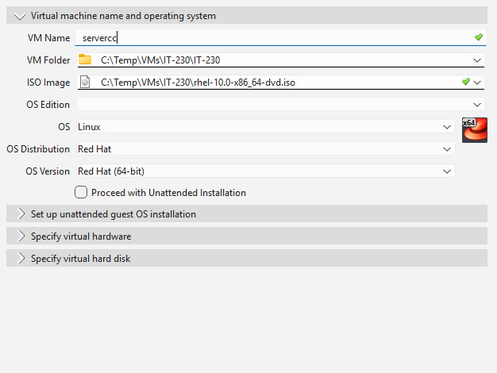

</template>

<template #1>

Give it 2048 MB of memory and 2 CPUs, and leave **Use EFI** unchecked

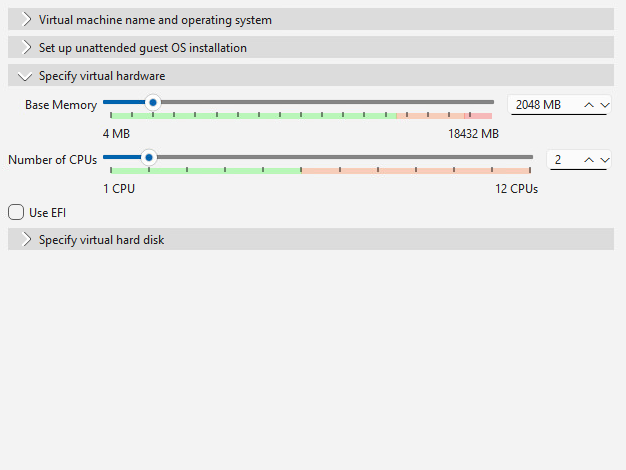

</template>

<template #2>

Create a new 10 GB virtual hard disk

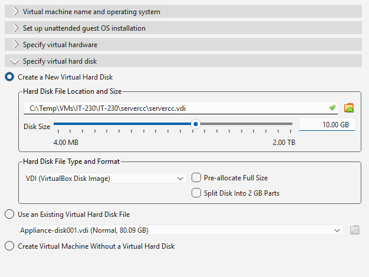

</template>

<template #3>

In **Settings**, then **Network**, leave Adapter 1 on NAT and attach Adapter 2 to the Internal Network `intnet`

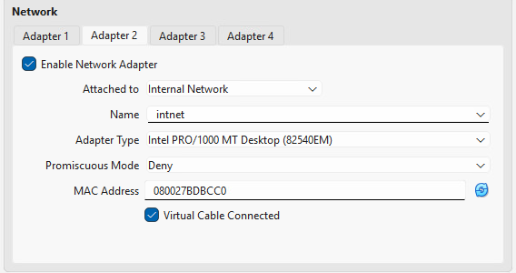

</template>

</v-switch>

---

# The Boot Menu

Select **Install Red Hat Enterprise Linux 10.0** now: it loads slowly on the VDI, so it runs while we go through the slides

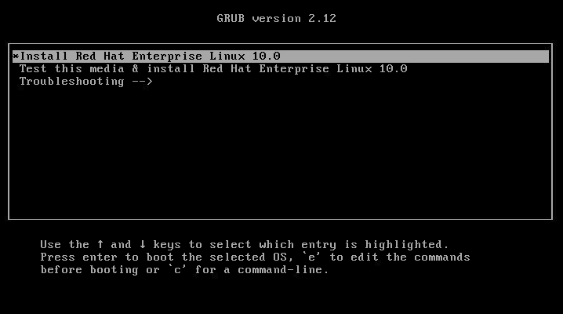

---
layout: two-cols-header
leftWidth: 55
---

# Download Installation Media

<https://developers.redhat.com/products/rhel/download>

::left::

### Boot ISO

- The installer only, much smaller
- Needs a network to download packages

### DVD ISO

- The installer and every package, about 8 GiB
- No network needed; use it for the lab

::right::

::bottom::

<Callout>

Write the ISO to a USB drive, or attach it to a virtual machine as a virtual CD-ROM

</Callout>

---
layout: two-cols-header
leftWidth: 62
---

# Installation Summary

::left::

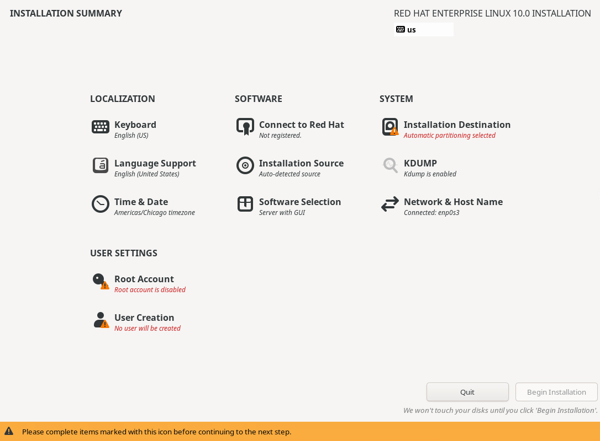

::right::

- The hub: every setting is reached from here
- A warning triangle marks an item you must complete
- Nothing is written to disk until <AccentText>Begin Installation</AccentText>

---

# The Installation Summary Hub

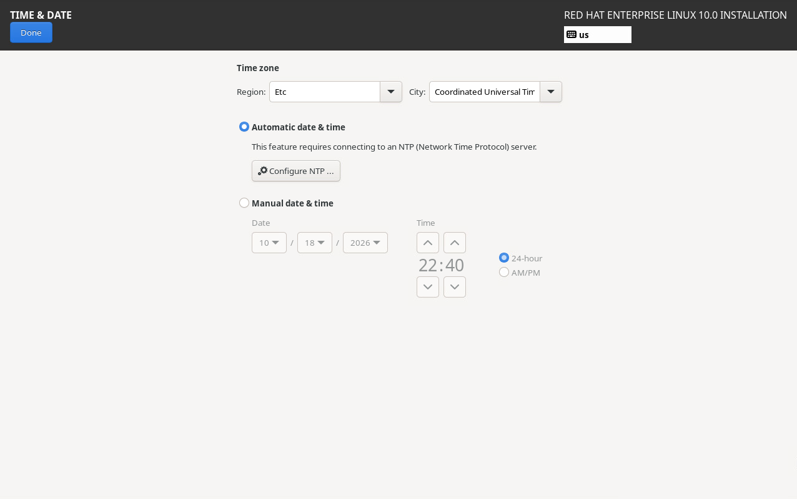

Time & Date

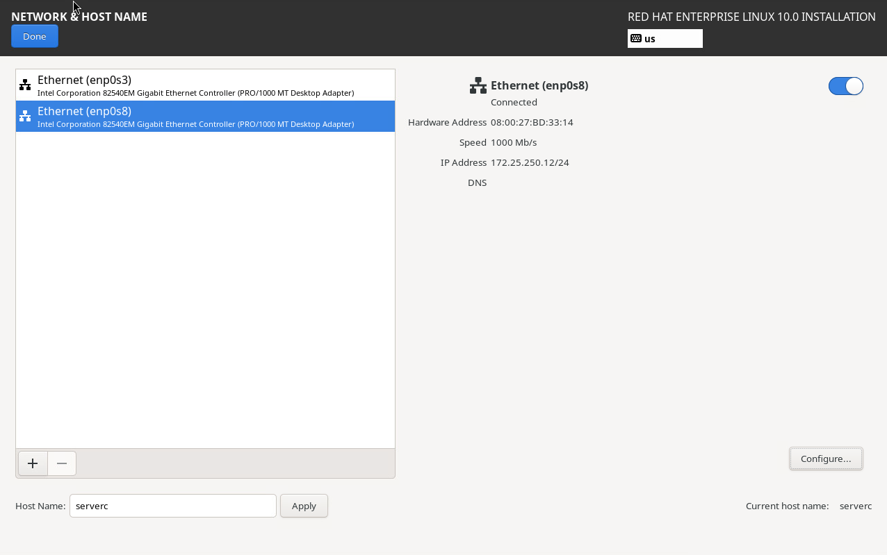

Network & Host Name

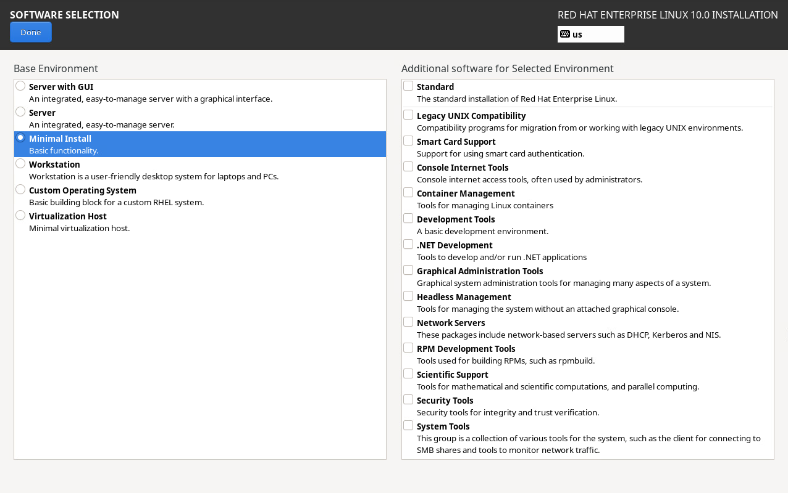

Software Selection

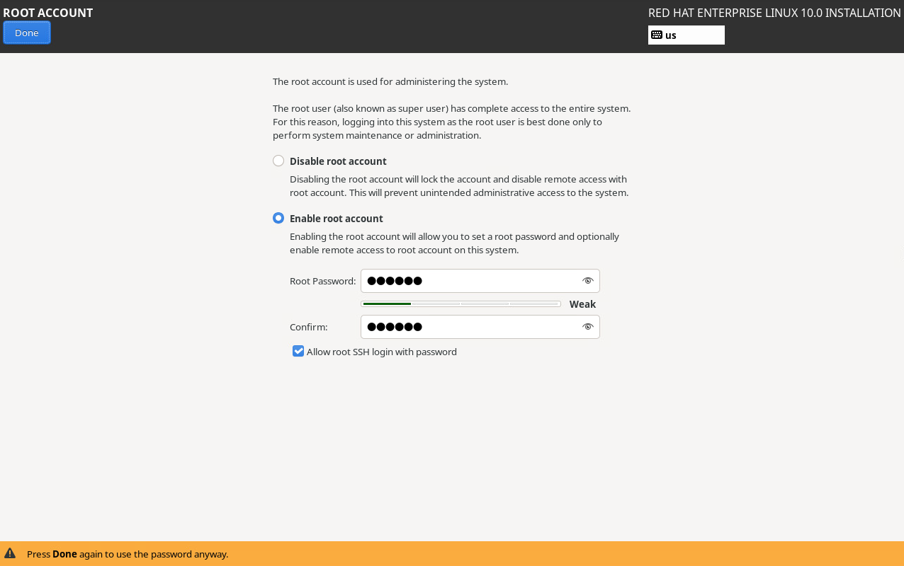

Root Account

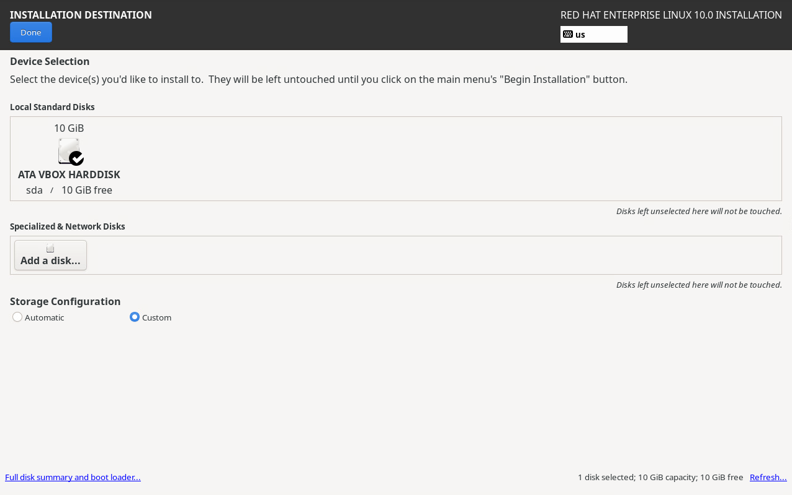

Installation Destination

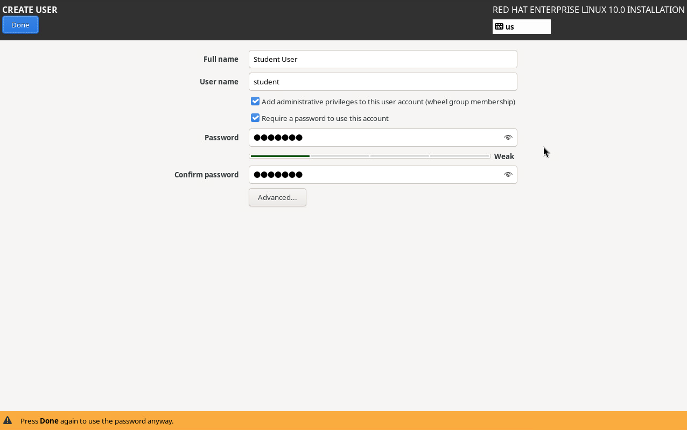

User Creation

<Arrow x1="276" y1="130" x2="387" y2="245" two-way color="var(--it230-color-accent-fill)" />
<Arrow x1="276" y1="282" x2="387" y2="282" two-way color="var(--it230-color-accent-fill)" />
<Arrow x1="276" y1="419" x2="387" y2="337" two-way color="var(--it230-color-accent-fill)" />
<Arrow x1="593" y1="245" x2="704" y2="130" two-way color="var(--it230-color-accent-fill)" />
<Arrow x1="593" y1="282" x2="704" y2="282" two-way color="var(--it230-color-accent-fill)" />
<Arrow x1="593" y1="337" x2="704" y2="419" two-way color="var(--it230-color-accent-fill)" />

---

# Standard Partitions

**Automatic** storage uses LVM and picks the sizes; **Custom** lets you choose

| Mount point | Size     | File system |
|-------------|----------|-------------|
| biosboot    | 1 MiB    | BIOS Boot   |
| `/boot`     | 1 GiB    | xfs         |
| swap        | 1 GiB    | swap        |
| `/`         | The rest | xfs         |

---
layout: two-cols-header
leftWidth: 60
---

# Root Account

::left::

### RHEL 10 disables `root` by default

Admins use `sudo` instead

<v-click>

### Enable it for the lab

Select **Enable root account** and set the lab password, `redhat`

SSH refuses password logins as `root` unless you also select **Allow root SSH login with password**

</v-click>

<v-click>

### Best practice

In production, leave `root` disabled and use a `wheel` administrator

</v-click>

::right::

---
layout: two-cols-header
leftWidth: 40
---

# Install Settings for `serverc`

::left::

| Virtual machine | Value                          |
|-----------------|--------------------------------|
| RAM             | 2048 MB                        |
| vCPUs           | 2                              |
| Disk            | 10 GB                          |
| Adapter 1       | NAT                            |
| Adapter 2       | Internal Network `intnet`      |

::right::

| Operating system | Value                                 |
|------------------|---------------------------------------|
| Software         | Minimal Install                       |
| Time zone        | UTC                                   |
| `enp0s8`         | `172.25.250.12/24`, no gateway or DNS |
| Host name        | `serverc`                             |
| `root`           | Enabled, password `redhat`            |
| User             | `student` / `student`, administrator  |

---

# Installation Complete

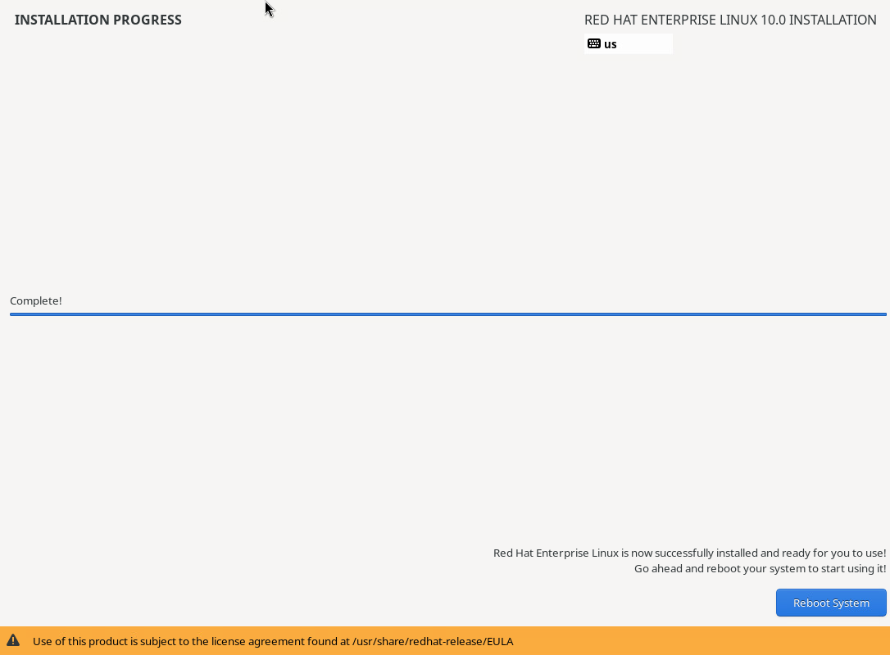

---
vertical: start
---

# Verify the Installation

<v-switch at="1">

<template #0>

Log in on the console as `student`; `hostname` prints `serverc`

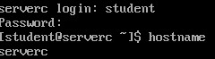

</template>

<template #1>

`ip addr`: `172.25.250.12/24` on `enp0s8`, and `10.0.2.15/24` from VirtualBox's NAT on `enp0s3`

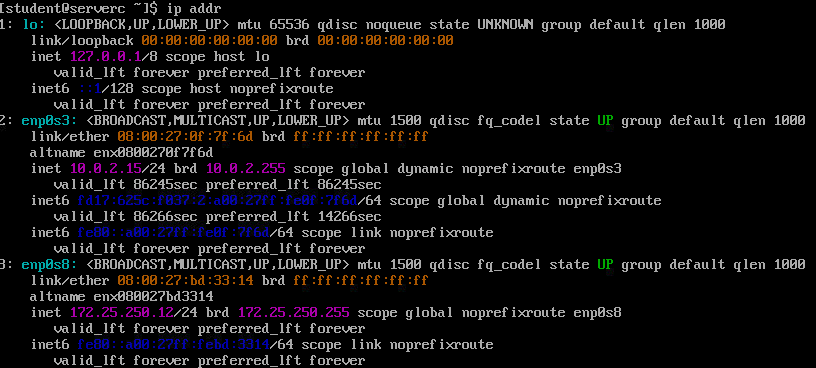

</template>

<template #2>

`lsblk`: four standard partitions on `sda`, and no LVM

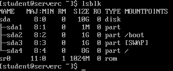

</template>

</v-switch>

---
layout: exercise
---

# Install RHEL on `serverc`

::goal::

Install RHEL 10 by hand with standard partitions

::environment::

**Host:** a new VirtualBox virtual machine, `serverc`, on your VDI

**Requirement:** the RHEL 10.0 DVD ISO, `C:\Temp\VMs\IT-230\rhel-10.0-x86_64-dvd.iso`

::workflow::

1. Create the `serverc` virtual machine in VirtualBox
2. Boot it from the RHEL 10.0 DVD
3. Set the time zone and software selection
4. Create standard partitions for `/boot`, swap, and `/`
5. Configure the network and host name
6. Enable `root` and create the `student` administrator
7. Begin the installation and reboot
8. Verify with `hostname`, `ip addr`, and `lsblk`
