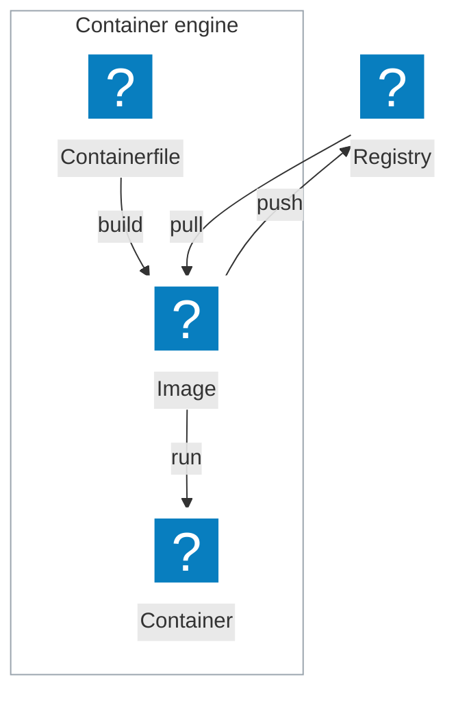
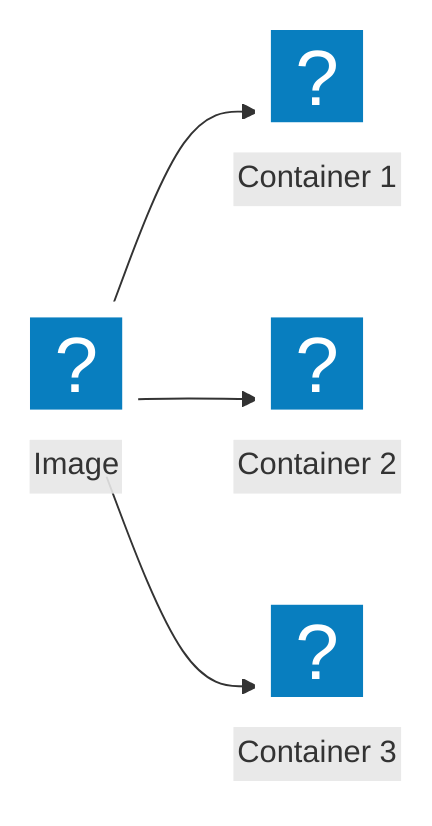
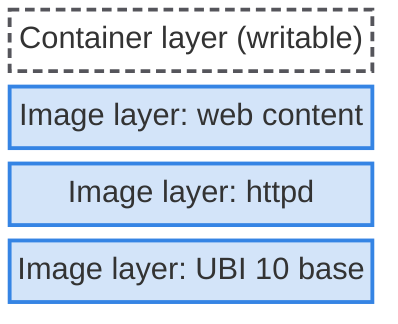

# Container Images

---
horizontal: center
vertical: center
---

# Images, Registries, and Containers



---
layout: two-cols-header
vertical: center
leftWidth: 65
---

# Images vs Instances

::left::

- A container is a running instance of a container image
- One image can create many containers

::right::



---
vertical: center
---

# Container Images

<IconGrid>
<IconGridItem icon="layers">

Read-only layers

</IconGridItem>
<IconGridItem icon="application">

The application

</IconGridItem>
<IconGridItem icon="package">

Its binaries and libraries

</IconGridItem>
<IconGridItem icon="code">

Its runtimes, such as Python

</IconGridItem>
<IconGridItem icon="terminal">

The command to run

</IconGridItem>
</IconGrid>

---
layout: two-cols-header
vertical: center
---

# Image Layers

::left::

- An image is a stack of read-only layers
- Each layer adds files to the one below
- A container adds one writable layer on top
- Removing the container deletes that layer

::right::



---
layout: two-cols-header
vertical: center
leftWidth: 53
---

# Container Registries

::left::

- Where images come from, searched in order
  - `registry.access.redhat.com`: no login
  - `registry.redhat.io`: login required
  - `docker.io`

::right::

<TerminalWindow title="student@servera:~">

```bash-session
student@servera:~$ podman info | grep -A4 registries
registries:
  search:
  - registry.access.redhat.com
  - registry.redhat.io
  - docker.io
```

</TerminalWindow>

::bottom::

Configured via `unqualified-search-registries` in:

- `/etc/containers/registries.conf` (System)
- `~/.config/containers/registries.conf` (User)

Browse Red Hat's images at [catalog.redhat.com](https://catalog.redhat.com) community images on [Quay.io](https://quay.io) or [Docker Hub](https://hub.docker.com/)

---
layout: two-cols-header
leftWidth: 28
vertical: center
---

# Podman Image Actions

::left::


::right::

| Command                           | Does                                |
| --------------------------------- | ----------------------------------- |
| `podman info`                     | Show Podman's settings              |
| `podman search TERM`              | Search the registries               |
| `podman search --list-tags IMAGE` | List an image's tags                |
| `podman pull IMAGE`               | Download an image                   |
| `podman images`                   | List local images                   |
| `podman image inspect IMAGE`      | Show an image's details             |
| `podman rmi IMAGE`                | Remove a local image                |

---
horizontal: center
---

# Image Names and Tags

<TextExplainer
  :lines="['registry.access.redhat.com/ubi10/ubi:latest']"
  :steps="[
    { line: 1, text: 'registry.access.redhat.com', explanation: 'The registry it comes from' },
    { line: 1, text: 'ubi10/ubi', explanation: 'The repository: the image\'s name' },
    { line: 1, text: 'latest', explanation: 'The tag, a version: latest when none is given' },
  ]"
/>

UBI images are Red Hat's Universal Base Images, free to use and share

---

# Pulling, Listing, and Removing Images

<TerminalWindow title="student@servera:~" :rows="15">

````md magic-move
```bash-session
student@servera:~$ podman pull registry.access.redhat.com/ubi10/ubi-minimal
Trying to pull registry.access.redhat.com/ubi10/ubi-minimal:latest...
Getting image source signatures
Checking if image destination supports signatures
Copying blob 3cfd5e1005a3 done   |
Copying config 73bcecbe7e done   |
Writing manifest to image destination
Storing signatures
73bcecbe7ef2422772a19f70bea7df93d76c6281d3ef1381fc1f4dea1d3814c9
```
```bash-session
student@servera:~$ podman pull registry.access.redhat.com/ubi10/ubi-minimal
Trying to pull registry.access.redhat.com/ubi10/ubi-minimal:latest...
Getting image source signatures
Checking if image destination supports signatures
Copying blob 3cfd5e1005a3 done   |
Copying config 73bcecbe7e done   |
Writing manifest to image destination
Storing signatures
73bcecbe7ef2422772a19f70bea7df93d76c6281d3ef1381fc1f4dea1d3814c9
student@servera:~$ podman images
REPOSITORY                                    TAG         IMAGE ID      CREATED     SIZE
registry.access.redhat.com/ubi10/ubi-minimal  latest      73bcecbe7ef2  2 days ago  87.9 MB
```
```bash-session
student@servera:~$ podman pull registry.access.redhat.com/ubi10/ubi-minimal
Trying to pull registry.access.redhat.com/ubi10/ubi-minimal:latest...
Getting image source signatures
Checking if image destination supports signatures
Copying blob 3cfd5e1005a3 done   |
Copying config 73bcecbe7e done   |
Writing manifest to image destination
Storing signatures
73bcecbe7ef2422772a19f70bea7df93d76c6281d3ef1381fc1f4dea1d3814c9
student@servera:~$ podman images
REPOSITORY                                    TAG         IMAGE ID      CREATED     SIZE
registry.access.redhat.com/ubi10/ubi-minimal  latest      73bcecbe7ef2  2 days ago  87.9 MB
student@servera:~$ podman rmi registry.access.redhat.com/ubi10/ubi-minimal
Untagged: registry.access.redhat.com/ubi10/ubi-minimal:latest
Deleted: 73bcecbe7ef2422772a19f70bea7df93d76c6281d3ef1381fc1f4dea1d3814c9
```
````

</TerminalWindow>

Docker Hub keeps its official images under `library/`, as in `docker.io/library/httpd`

---

# Inspecting an Image

<TerminalWindow title="student@servera:~">

```bash-session
student@servera:~$ podman image inspect --format '{{.Created}}' ubi10/ubi
2026-11-12 21:48:07.914391457 +0000 UTC
student@servera:~$ podman image inspect --format '{{.Config.ExposedPorts}}' ubi10/ubi
map[]
```

</TerminalWindow>

Without `--format`, `podman image inspect` prints every detail as JSON, about 180 lines

`--format` prints one field: here, when the image was built and the ports it exposes, none for a base image

---
layout: exercise
---

# Manage Container Images

::goal::

Find, download, inspect, and remove web server images

::environment::

**Host:** `servera`

**Prerequisite exercise:** Run Your First Container

::workflow::

1. Find the registries Podman searches
2. Search the registries for an `httpd-24` image
3. Pull `ubi10/httpd-24` from `registry.access.redhat.com` and `httpd` from `docker.io`
4. List the local images
5. Find the ports each httpd image exposes
6. Remove the `docker.io` image

---
layout: exercise
variant: recording
---

<script setup>
import castUrl from "./exercises/manage-container-images-exercise.cast?url";
</script>

# Manage Container Images

::recording::

<AsciinemaPlayer
    :src="castUrl"
    label="Screen recording of the instructor finding the registries Podman searches in /etc/containers/registries.conf, searching them for httpd-24, pulling ubi10/httpd-24 from registry.access.redhat.com and httpd from docker.io, listing the local images, reading the ports each image exposes with podman image inspect --format, and removing the docker.io image."
/>

::resources::

<a href="../resources/manage-container-images-exercise.html" target="_blank" rel="noopener noreferrer" aria-label="Read the written Manage Container Images exercise in a new tab">Written exercise</a>
