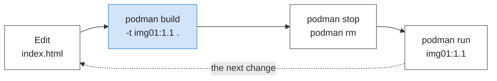

# Containerfiles

---
vertical: center
horizontal: center
---

# The Containerfile

Each instruction adds a layer to the image

| Instruction  | Does                                                       |
| ------------ | ---------------------------------------------------------- |
| `FROM`       | Start from a base image                                    |
| `RUN`        | Run a command while building, such as `dnf install`        |
| `COPY`       | Copy a file from the build directory into the image        |
| `EXPOSE`     | Record the port the application listens on; opens nothing  |
| `CMD`        | The command a container runs, unless `podman run` names another |
| `ENTRYPOINT` | Like `CMD`, but a command on `podman run` cannot replace it |


---
vertical: center
horizontal: center
---

# A Containerfile, Line by Line

<TextExplainer
  :lines="[
    'FROM registry.access.redhat.com/ubi10/ubi',
    'RUN dnf install -y httpd',
    'COPY index.html /var/www/html/',
    'EXPOSE 80',
    'CMD [&quot;/usr/sbin/httpd&quot;, &quot;-DFOREGROUND&quot;]',
  ]"
  :steps="[
    { line: 1, explanation: 'Start from the UBI 10 base image' },
    { line: 2, explanation: 'Install httpd while the image is built' },
    { line: 3, explanation: 'Copy index.html from the build directory into the image' },
    { line: 4, explanation: 'Record that httpd listens on port 80; -p still publishes it' },
    { line: 5, explanation: 'Run httpd in the foreground: the container stops when it does' },
  ]"
/>

Saved as `Containerfile`, in a directory of its own with `index.html` beside it

---

# Building an Image

<TerminalWindow title="student@servera:~/img01">

```bash-session
student@servera:~/img01$ podman build -t img01:1.0 .
STEP 1/5: FROM registry.access.redhat.com/ubi10/ubi
STEP 2/5: RUN dnf install -y httpd
--> Using cache 069f164ce2284c5baf5daa0c7ce8e42dadbfec58bde72f787c95ae128ccfdce3
--> 069f164ce228
STEP 3/5: COPY index.html /var/www/html/
--> Using cache 0a1c4c5f5a002b3ea9801545b4785c58c645433fc2433baf6212cbbdc7965d69
--> 0a1c4c5f5a00
STEP 4/5: EXPOSE 80
--> Using cache b4056d47a7a44ee90fc44c242266713cba1afcd584b28537a4a02f9742eb75de
--> b4056d47a7a4
STEP 5/5: CMD ["/usr/sbin/httpd", "-DFOREGROUND"]
--> Using cache ac757c23222fde8b30598b4ed243bb0347100e5753956acc6ff42bca625513be
COMMIT img01:1.0
--> ac757c23222f
Successfully tagged localhost/img01:1.0
ac757c23222fde8b30598b4ed243bb0347100e5753956acc6ff42bca625513be
```

</TerminalWindow>

`-t` names and tags the image and `.` is the build directory

---
horizontal: center
vertical: center
---

# Every Change Is a New Image



A page copied in with `COPY` is part of the image

If you change index.html you must rebuild to create a new image

Then run an instance of the new image

---
vertical: center
---

# Tags and Registries

| Command                                          | Does                                                |
|--------------------------------------------------|-----------------------------------------------------|
| `podman tag img01:1.0 img01:latest`              | Give an image another name or tag                   |
| `podman image push img01:1.0 REGISTRY/img01:1.0` | Upload it to a registry you can log in to           |
| `podman image prune`                             | Remove dangling images: old builds left as `<none>` |
| `podman image prune -a`                          | Remove every image that no container uses           |

---
layout: exercise
---

# Build a Container Image

::goal::

Build your own web server image, then change the page it serves

::environment::

**Host:** `servera`

**Prerequisite exercise:** Manage a Container

::workflow::

1. Write a page and a Containerfile that copies it into a UBI 10 image with httpd
2. Build it as `intranet:1.0`, run it with host port 8082, and test it
3. Change the page and test again
4. Build `intranet:1.1` and replace the container with one from it
5. Test again and list your images

---
layout: exercise
variant: recording
---

<script setup>
import castUrl from "./exercises/build-a-container-image-exercise.cast?url";
</script>

# Build a Container Image

::recording::

<AsciinemaPlayer
    :src="castUrl"
    label="Screen recording of the instructor writing an index.html page and a Containerfile that installs httpd in a UBI 10 image and copies the page in, building intranet:1.0 and serving it on host port 8082, changing the page and showing the container still serves the old one, building intranet:1.1 and replacing the container with one from it, and listing both images."
/>

::resources::

<a href="../resources/build-a-container-image-exercise.html" target="_blank" rel="noopener noreferrer" aria-label="Read the written Build a Container Image exercise in a new tab">Written exercise</a>
