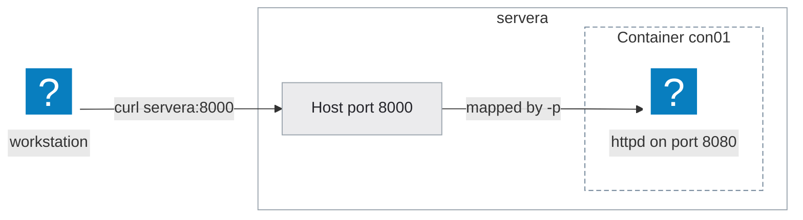

# Running Containers

---
layout: two-cols-header
leftWidth: 28
vertical: center
---

# Podman Container Actions

::left::


::right::

| `podman run` option | Does                                    |
| ------------------- | --------------------------------------- |
| `-d`                | Run in the background (detach)          |
| `-it`               | Interactive, with a terminal            |
| `--rm`              | Remove the container when it stops      |
| `-p 8000:8080`      | Host port 8000 to container port 8080   |
| `-e GREETING=Hello` | Set an environment variable             |
| `--name con01`      | Name the container                      |
| `IMAGE /bin/bash`   | Run another command instead of the image's own |

---

# Foreground and Background

<TerminalWindow title="student@servera:~">

```bash-session
student@servera:~$ podman run -d --name con01 -p 8000:8080 registry.access.redhat.com/ubi10/httpd-24
e97bfd12c14c547bbba100f37fff43e2715ebbc3e94d912840cdfa3a60a238d1
student@servera:~$ podman ps --format "{{.Names}}  {{.Status}}  {{.Ports}}"
con01  Up 4 seconds  0.0.0.0:8000->8080/tcp, 8443/tcp
student@servera:~$ curl -s localhost:8000 | grep '<title>'
		<title>Test Page for the HTTP Server on Red Hat Enterprise Linux</title>
```

</TerminalWindow>

Without `-d`, a container runs in the foreground: it holds the terminal and prints its log until Ctrl+C stops it

Plain `podman ps` also shows each container's ID, image, command, and age; `curl -s` drops curl's progress meter

---
vertical: center
---

# Listing and Entering Containers

| Command                           | Does                                       |
| --------------------------------- | ------------------------------------------ |
| `podman ps`                       | List running containers                    |
| `podman ps -a`                    | List all containers, stopped ones too      |
| `podman logs con01`               | Show what the container has printed        |
| `podman exec -it con01 /bin/bash` | Open a shell inside a running container    |

A stopped container is still there until it is removed: `podman ps -a` shows it

---

# Looking Inside a Container

<TerminalWindow title="student@servera:~">

```bash-session
student@servera:~$ podman exec -it con01 /bin/bash
bash-5.2$ id
uid=1001(default) gid=0(root) groups=0(root)
bash-5.2$ ps aux
bash: ps: command not found
bash-5.2$ exit
exit
student@servera:~$
```

</TerminalWindow>

`exec` runs a command in a container that is already running; the prompt changes because the shell is inside it

The image carries what httpd needs, not every tool, and `exit` leaves the shell while the container keeps running

---
vertical: center
---

# Stopping and Removing Containers

| Command                | Does                                               |
| ---------------------- | -------------------------------------------------- |
| `podman stop con01`    | Stop it: SIGTERM, then SIGKILL after 10 seconds    |
| `podman stop --all`    | Stop every running container                       |
| `podman kill con01`    | Stop it at once: SIGKILL                           |
| `podman restart con01` | Restart it, or start it again if it is stopped     |
| `podman rm con01`      | Remove a stopped container                         |
| `podman rm -a`         | Remove every stopped container                     |
| `podman rm -f con01`   | Stop and remove it in one step                     |

---
horizontal: center
---

# Port Mapping



`-p 8000:8080` takes the host port first, then the container's port. Other hosts reach it once the firewall allows the host port:

```bash
sudo firewall-cmd --add-port=8000/tcp
```

---
layout: exercise
---

# Manage a Container

::goal::

Run, explore, and remove containers

::environment::

**Hosts:** `servera`, `workstation`

**Prerequisite exercise:** Manage Container Images

::workflow::

1. Remove the stopped containers left from the first exercise
2. Run the httpd image in the foreground, then stop it
3. Run it in the background as `intranet`, publishing host port 8081
4. Check it with `curl` and `podman logs`
5. Open a shell in it and look around
6. Reach it from `workstation`
7. Print an environment variable from a container that removes itself
8. Stop and remove `intranet`

---
layout: exercise
variant: recording
---

<script setup>
import castUrl from "./exercises/manage-a-container-exercise.cast?url";
</script>

# Manage a Container

::recording::

<AsciinemaPlayer
    :src="castUrl"
    label="Screen recording of the instructor removing the stopped containers left from the first exercise, running the httpd image in the foreground and stopping it with Ctrl+C, running it in the background as intranet on host port 8081, checking it with curl and podman logs, opening a shell in it with podman exec, opening port 8081 in servera's firewall and reaching the page from workstation, printing an environment variable from a container started with --rm, and stopping and removing intranet."
/>

::resources::

<a href="../resources/manage-a-container-exercise.html" target="_blank" rel="noopener noreferrer" aria-label="Read the written Manage a Container exercise in a new tab">Written exercise</a>
