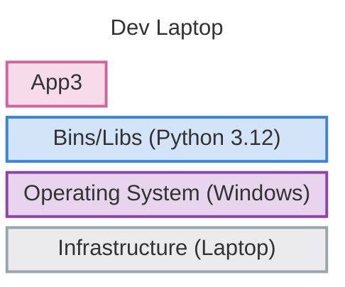
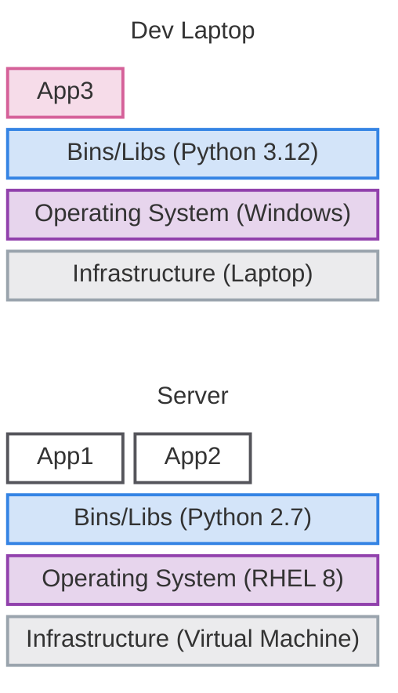
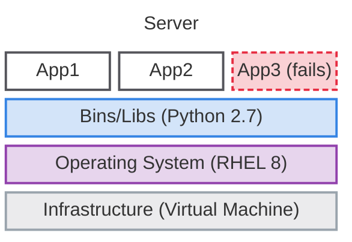
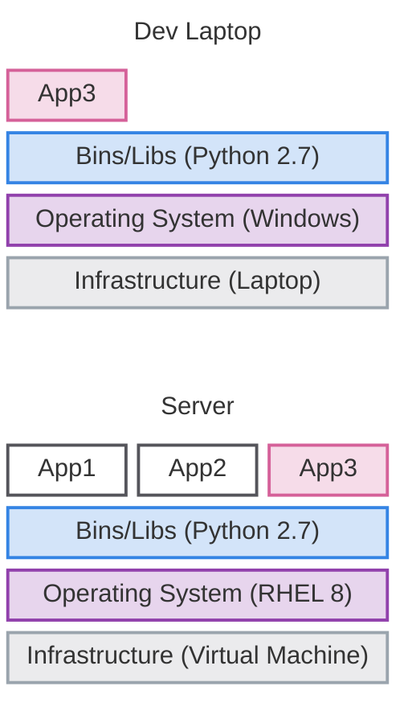
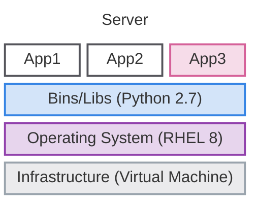
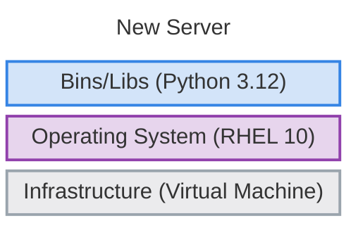
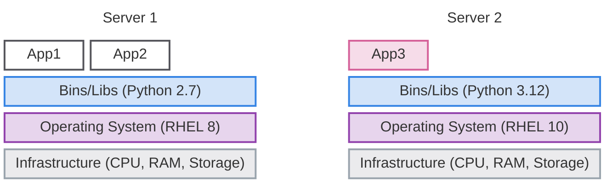
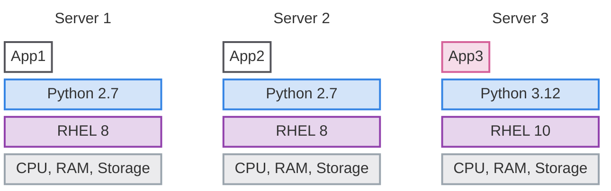
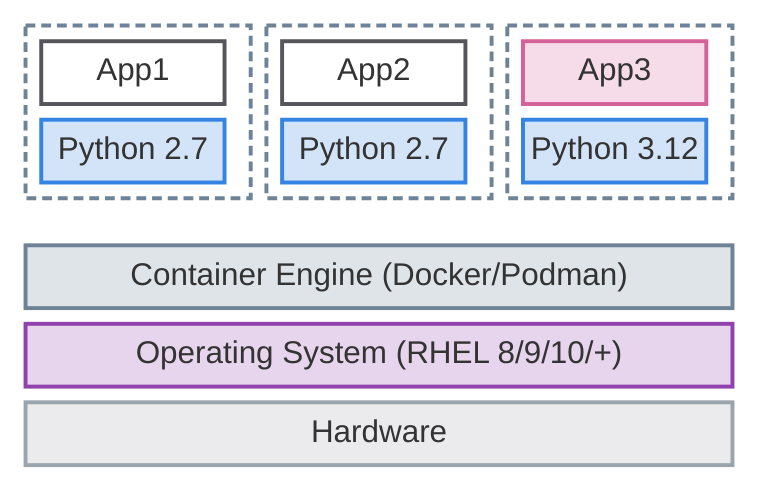
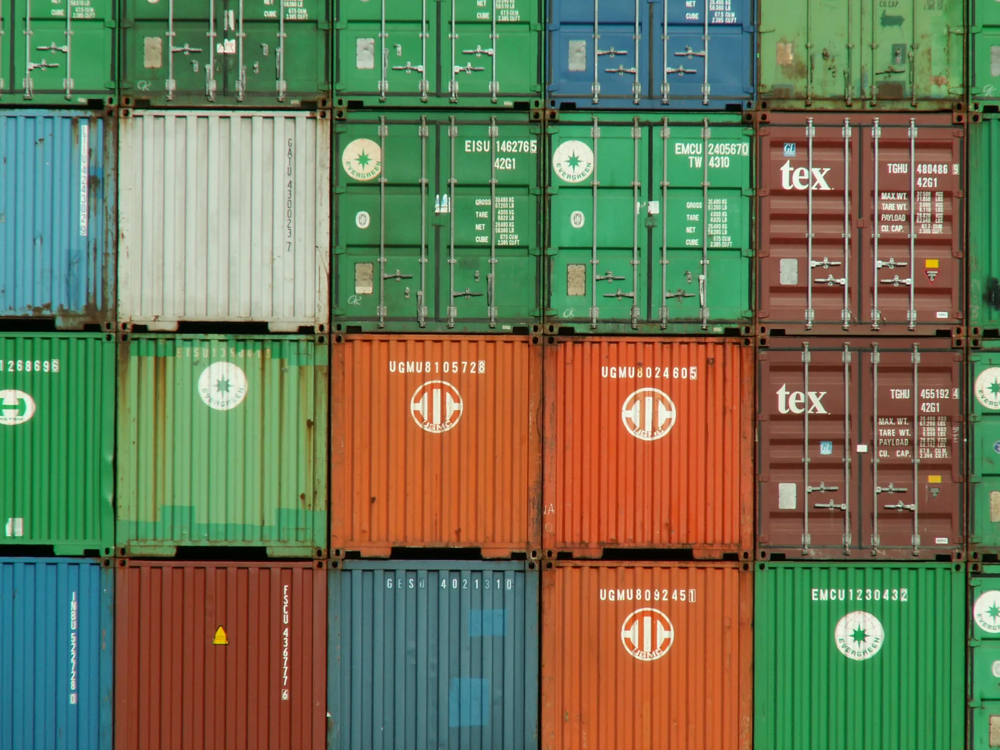

# Why Containers

---
layout: center
---

# What Is a Container?

A <AccentText>process</AccentText> packaged with <AccentText>everything it needs</AccentText> to run

---
layout: two-cols-header
vertical: center
---

# Why Containers?

::left::

- Dev installs Python 3.12
- Dev creates App3

::right::



---
layout: two-cols-header
vertical: center
---

# Why Containers?

::left::

- Developer's laptop
  - Python 3.12
- Server
  - Python 2.7

::right::



---
layout: two-cols-header
vertical: center
---

# Why Containers?

::left::

- Ops tries to deploy App3
- Server
  - Python 2.7
- Ops: "Doesn't work on server!"
- Dev: "Works on my machine!"

::right::



---
layout: two-cols-header
vertical: center
leftWidth: 65
---

# Why Containers?

::left::

- Manager: "All developers must use Python 2.7!"
- Dev: Rewrites App3 in Python 2.7
  - Not happy about it
- App3 becomes a big hit! Users love it.
- Later: Python 2.x goes End of Life

::right::



---
layout: two-cols-header
leftWidth: 55
---

# Why Containers?

::left::

- Manager: "Please upgrade App3 to Python 3.12"
- Devs: "We can't, the server only has Python 2.7"
- Manager: "Get a new server"



::right::

<br />
<br />
<br />
<br />
<br />
<br />



---
horizontal: center
---

# Why Containers?

Different VMs to isolate workloads



---
vertical: center
horizontal: center
---

# VM as the Unit of Isolation



<br />

Every app carries a whole operating system

---
layout: two-cols-header
vertical: center
horizontal: center
---

# Containerized Apps



---

# Containers and Virtual Machines

|              | Virtual machine                       | Container                    |
| ------------ | ------------------------------------- | ---------------------------- |
| Runs on      | A hypervisor                          | A container engine           |
| Carries      | A whole OS: boot loader, kernel, init | The app and its libraries    |
| Kernel       | Its own                               | The host's                   |
| Size         | Gigabytes                             | Megabytes                    |
| Starts by    | Booting an operating system           | Starting a process           |

At scale, Kubernetes and Red Hat OpenShift run containers across many hosts

---
layout: center
---

# What Is a Container?

A <AccentText>process</AccentText> packaged with <AccentText>everything it needs</AccentText> to run

---
horizontal: center
---

# How Containers Are Isolated

Containers make use of Linux kenel features for isolation

<IconGrid>
<IconGridItem icon="view-off">

Namespaces: a private view of the system

</IconGridItem>
<IconGridItem icon="dashboard">

cgroups: limits on CPU and memory

</IconGridItem>
<IconGridItem icon="security">

SELinux: a label that confines it

</IconGridItem>
<IconGridItem icon="locked">

seccomp: fewer kernel calls allowed

</IconGridItem>
</IconGrid>


---
layout: two-cols-header
leftWidth: 55
vertical: center
---

# Container Engines

::left::

- Docker
  - 2013
  - Client and server, with a daemon
- Podman
  - 2019, from Red Hat
  - Fork and exec, no daemon
  - Runs like a regular Linux process
- Both run standard images
  - OCI: Open Container Initiative

::right::



<div class="text-xs">

Photograph by [Alf van Beem](https://commons.wikimedia.org/wiki/User:Alfvanbeem), [CC0](https://creativecommons.org/publicdomain/zero/1.0/), via [Wikimedia Commons](https://commons.wikimedia.org/wiki/File:Different_colored_containers_pic2.JPG)

</div>

---

# Installing Podman and Running a Container

```bash
sudo dnf install -y podman
```

<TerminalWindow title="student@servera:~">

```bash-session
student@servera:~$ podman -v
podman version 5.4.0
student@servera:~$ podman run registry.access.redhat.com/ubi10/ubi echo Hello
Trying to pull registry.access.redhat.com/ubi10/ubi:latest...
Getting image source signatures
Checking if image destination supports signatures
Copying blob 6cbfcbeb6614 done   |
Copying config 7474288886 done   |
Writing manifest to image destination
Storing signatures
Hello
```

</TerminalWindow>

The first run downloads the image, and the container stops when its command ends

---
layout: exercise
---

# Run Your First Container

::goal::

See what a container brings with it and what it shares with its host

::environment::

**Host:** `servera`

::workflow::

1. Install Podman
2. Check the Podman version
3. Compare the RHEL release in a UBI 10 container and on `servera`
4. Compare the kernel in a UBI 10 container and on `servera`

---
layout: exercise
variant: recording
---

<script setup>
import castUrl from "./exercises/run-your-first-container-exercise.cast?url";
</script>

# Run Your First Container

::recording::

<AsciinemaPlayer
    :src="castUrl"
    label="Screen recording of the instructor installing podman on servera with dnf, checking its version, running cat /etc/redhat-release in a UBI 10 container and on servera to compare their releases, and running uname -r in both to show the container uses servera's kernel."
/>

::resources::

<a href="../resources/run-your-first-container-exercise.html" target="_blank" rel="noopener noreferrer" aria-label="Read the written Run Your First Container exercise in a new tab">Written exercise</a>
